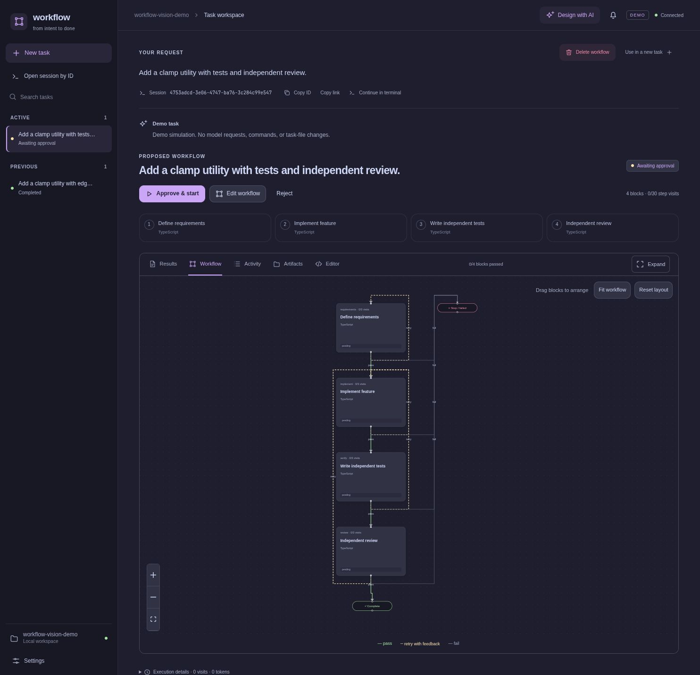
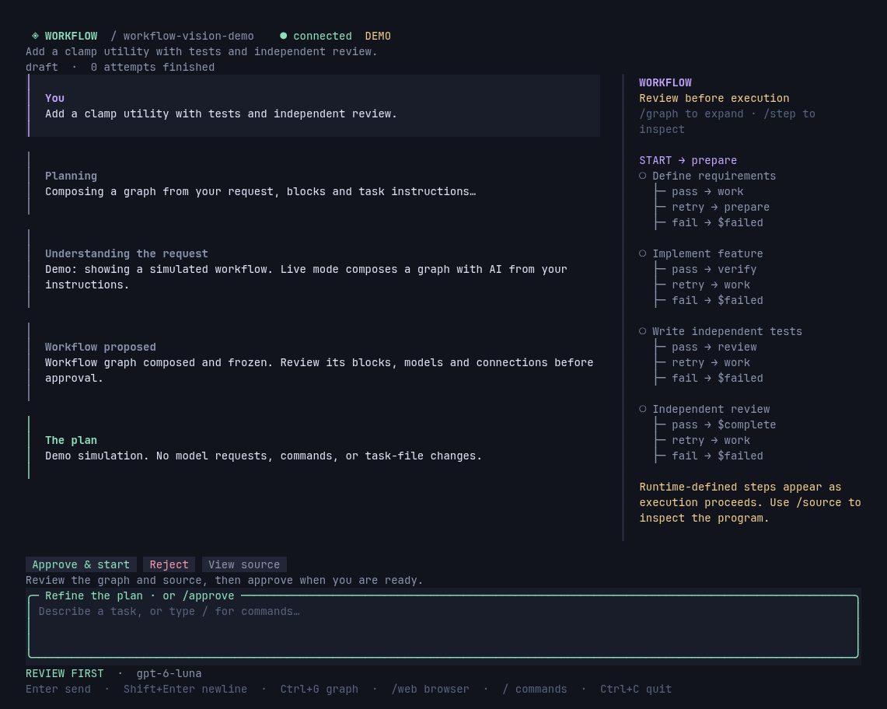

# Workflow

**Turn a coding request into a workflow you can inspect, run, and resume.**

Workflow is an AI development engine with a browser workspace and terminal clients. Describe a task, attach files or screenshots, and the orchestrator composes a TypeScript workflow from your reusable blocks, task instructions, and model profiles. Review the graph, then start it—or enable automatic execution.





Both screenshots show the same disposable demo task. Demo mode simulates AI work; it does not change project files.

## Why this project exists

Finishing a coding task often takes several kinds of work: understand the request, implement it, write or run tests, review the result, address feedback, and sometimes commit and push. Workflow makes those responsibilities and their connections explicit.

- **Make the process visible.** See the proposed graph before execution, the blocks currently running, and the results and logs of each attempt.
- **Give different work to different models.** Describe model profiles for implementation, careful review, or routine work. Let the orchestrator assign them, or choose models in code.
- **Use code for predictable operations.** A test, build, or push can run directly without a model call. AI is a capability inside a TypeScript block.
- **Control what models receive.** Pass selected typed outputs between steps. Each AI call starts fresh; `context: "none"` omits inherited workflow context, independently of tool access.
- **Turn feedback into a controlled loop.** A test block returns diagnostics; an implementation block fixes the problem. Conditions, explicit outcomes, and visit limits decide what happens next.
- **Keep progress across interruptions.** Temporal records execution history. Completed work is retained, and interrupted attempts have an explicit recovery and retry path.
- **React to GitHub events.** Configure new-issue and new-PR triggers against a tested workflow. Persistent polling and a project queue retain work across restarts; results can stay local or be posted as a GitHub comment. [Set up triggers](docs/triggers.md).

It is useful when you want a repeatable development process with autonomous execution and inspectable results. For a one-off question, there may be no reason to create a workflow.

## How it works


The coordinator uses the supplied request, context, task instructions, blocks, and model profiles. Repository inspection happens inside execution blocks. A task instruction such as “bug fix” describes how to approach that kind of work; it does not prescribe a fixed graph.

| Concept | What you define |
| --- | --- |
| **Block** | A reusable TypeScript function with optional AI calls, commands, inputs, and outputs. |
| **Workflow** | Steps composed into sequences, branches, parallel groups, and bounded loops. |
| **Task instructions and model profiles** | Guidance the orchestrator uses to choose blocks and models for a particular request. |

The web UI uses Vue, Vue Flow, CodeMirror, and Catppuccin Mocha. The terminal workspace uses OpenTUI. Pi provides embedded model sessions and authentication integration; Temporal provides durable execution. Workflow owns the task workspace, configuration, approval flow, and results. [Read the design rationale](docs/concepts.md) or [explore the architecture](docs/architecture.md).

## Get started

Requires **Bun 1.4.2+** and Bash. Git and your project's build/test tools must be available for blocks that use them. Workflow itself does not require a separate Node.js installation.

Install from this repository:

```sh
git clone https://github.com/cjvnjde/workflow.git
cd workflow
bun install --frozen-lockfile --ignore-scripts
bun run build
bun link
```

Connect once, then initialize and configure each project:

```sh
workflow login openai           # account login; API-key login is also available
workflow model                  # shared default, saved in your home directory
cd /path/to/your/project
workflow init --instructions "Preserve public APIs and use the existing test framework."
workflow setup                  # AI inspects this project and tailors its library
workflow
```

`init` only creates configuration and starter TypeScript blocks. `setup` uses your chosen default model to inspect the repository and generate model profiles, reusable blocks, and task instructions for review, bug fixes, features, and documentation. It refreshes the connected catalog and asks for suitable current models with different costs and capabilities. To choose a project default during setup, use `workflow setup --model openai/gpt-6.1-sol --thinking medium`. Only models available through your connection can be selected.

Open **http://127.0.0.1:4310** (or use `workflow tui`):

1. The setup checklist shows your connection, default model, and library status.
2. Review or edit the generated configuration in **Settings**. Provider login and model selection are also available there.
3. Create a **New task**, describe the desired result, and attach useful context.
4. Inspect the proposed graph and select **Approve & start**.
5. Follow the active blocks and open **Results** for the outcome, checks, and downloadable artifacts.

The current directory is the project; there is no project-path argument. Credentials are shared across projects in `~/.config/workflow/` by default. Setup is explicit: ordinary startup does not regenerate configuration or spend AI usage on setup. Use `workflow setup --regenerate` when you want a fresh project-specific library. Review is the default approval mode.

[The getting-started guide](docs/getting-started.md) covers running without a PATH installation, development mode, first-task examples, and setup troubleshooting.

## Choose an interface

```sh
workflow                       # start/reuse background engine, API, and web GUI
workflow tui                   # full terminal workspace: chat, graph, tools, approval
workflow attach <session-id>   # reopen a task or run from either interface
workflow status                # show the running host and URL
workflow stop                  # stop the host; retain saved work
workflow serve --no-web         # explicit foreground engine and API only
workflow exec verify.ts         # execute directly in the terminal, without HTTP
workflow run verify.ts --approve --wait  # execute through a running server
```

In `workflow tui`, describe a task, inspect `/graph`, and `/approve` or `/reject` it. Use `/web` to open the same session in a browser, `/id` to show its ID, and `/open <id>` or `/sessions` to reopen work. The browser's **Open session by ID** accepts an ID or copied session link; **Continue in terminal** copies the matching CLI command. Opening a session does not automatically resume paused execution. [The terminal guide](docs/terminal.md) covers commands, shortcuts, and server attachment.

The engine's application API is independent of presentation. The web GUI, terminal workspace, and CLI commands share a validated HTTP client; embedded hosts can call the application directly. [Engine and clients](docs/clients.md) covers server access, integration APIs, and separate builds. Desktop and mobile GUIs can use the same interfaces; those additional clients are not included yet.

The public modules are `predictable-workflow/core` (planning, execution, persistence), `/web` (HTTP and browser hosting), and `/terminal` (terminal client and UI). They are shipped in one package; older `/engine` and `/http` imports remain supported. The background host outlives all browser and terminal clients. Use `workflow stop` to shut it down; `workflow serve` remains available for an explicit foreground host.

## Workflows are TypeScript

Use `step`, `sequence`, `parallel`, `when`, and `repeatUntil` to compose ordinary code blocks. This complete example runs two independent checks and collects their results without calling a model:

```ts
import { workflow, block, step, sequence, parallel, z } from "workflow";

const check = block({
  input: z.object({ command: z.string() }),
  async run(ctx) {
    const result = await ctx.exec(ctx.input.command);
    const passed = result.exitCode === 0 && !result.timedOut;
    ctx.summary(result.output || (passed ? "Check passed." : "Check failed."));
    ctx.outcome(passed ? "pass" : "fail");
    return { passed, output: result.output };
  },
});

const tests = step("tests", check, { inputs: { command: "bun test" } });
const types = step("types", check, { inputs: { command: "bun run typecheck" } });
const report = step("report", block({
  input: z.object({ tests: z.string(), types: z.string() }),
  run(ctx) {
    ctx.artifact("tests.txt", ctx.input.tests);
    ctx.artifact("types.txt", ctx.input.types);
    return "Tests and typechecking passed.";
  },
}), {
  inputs: ctx => ({
    tests: ctx.output(tests)!.output,
    types: ctx.output(types)!.output,
  }),
});

export default workflow({
  name: "Verify project",
  flow: sequence(parallel([tests, types], { concurrency: 2 }), report),
});
```

Use commands available in your project. Parallel blocks share its working directory; checks that rewrite the same files should run in sequence.

Import the source through **New task → Use a TypeScript workflow**, or save it in your project and run `workflow run verify.ts` while its server is running. Inside a block, `ctx.ai({ prompt, model?, output? })` adds a model session with optional typed output.

Use `defineTool()` for typed operations shared by code and models: call one with `ctx.call(tool, input)` or expose it through `ctx.ai({ tools: [tool], ... })`. Implementations are frozen with approval, and structured activity records connect each call to its file/command effects. See [shared tools and replay rules](docs/tools.md) and the [example](examples/shared-tools.ts).

For an implementation/review loop driven by `review.approved`, see [the composed workflow example](examples/composed.ts). The [workflow guide](docs/workflows.md) explains conditions, outcomes, typed handoffs, model overrides, and limits.

## Documentation

Start at **[docs/README.md](docs/README.md)** for reading paths and a complete index.

| I want to… | Read |
| --- | --- |
| Understand why Workflow exists and its core concepts | [Concepts and design](docs/concepts.md) |
| Install it and run my first task | [Getting started](docs/getting-started.md) |
| Write sequences, branches, parallel groups, and loops | [Writing workflows](docs/workflows.md) |
| Build reusable code and AI blocks | [Writing blocks](docs/blocks.md) · [Contracts, testing and evidence](docs/block-contracts-and-evidence.md) |
| Configure models, task instructions, skills, and MCP | [Configuration](docs/configuration.md) |
| Understand statuses, retries, recovery, and backups | [Running and recovering workflows](docs/operations.md) |
| Run automatically for new GitHub issues or PRs | [GitHub triggers](docs/triggers.md) |
| Work entirely in a terminal | [Terminal workspace](docs/terminal.md) |
| Embed the engine or build another UI | [Engine and clients](docs/clients.md) |
| Use the CLI or local HTTP API | [Command and API reference](docs/reference.md) |
| Understand the implementation or contribute | [Architecture](docs/architecture.md) · [Development](docs/development.md) |

## Execution boundaries

Workflow is a **single-user local application**. AI tools and commands run with the server user's filesystem, environment, and network access. Approval controls when a workflow starts; it is not an OS sandbox. File-tool recovery covers managed writes, while shell commands, Git operations, and external effects need separate inspection before a retry.

One workflow executes per project at a time, with explicit parallelism inside it. Provider errors, failed checks, exhausted limits, and unsuccessful planning can still stop a task. [Operations and current limitations](docs/operations.md) explain what can be resumed and what must be corrected first.

## Develop Workflow

```sh
bun run dev        # live backend + Vite at http://127.0.0.1:5173
bun run test       # build + backend/integration tests
bun run test:e2e   # build + headless browser tests
```

`dev` and `start` use real AI. Paid/subscription integration testing is a separate opt-in command, `bun run test:live`. See [Development](docs/development.md) for prerequisites, focused checks, and live-test scenarios.
