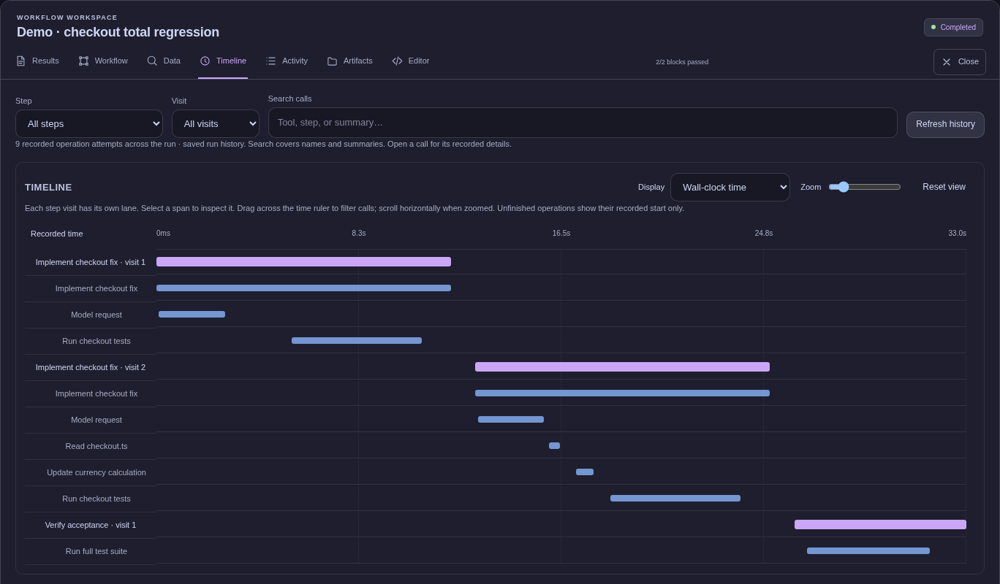
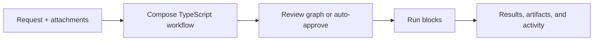
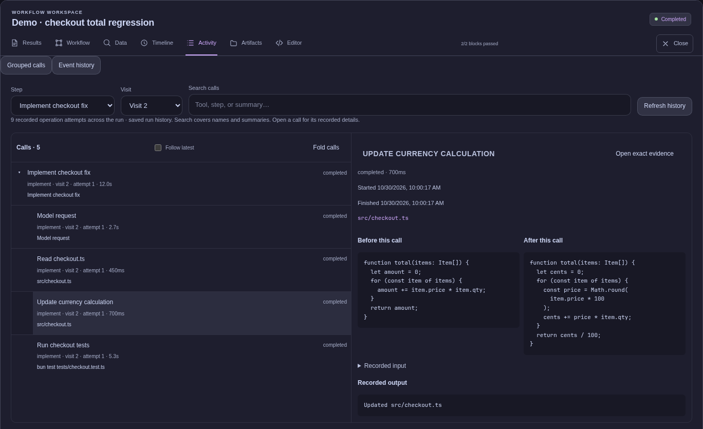

# Workflow

**Turn a coding request into a workflow you can inspect, run, and resume.**

Workflow is an AI development engine with a browser workspace and terminal clients. Describe a task, attach files or screenshots, and the orchestrator composes a TypeScript workflow from your reusable blocks, task instructions, and model profiles. Review the graph, then start it—or enable automatic execution.

## Get started

Requires **Bun 1.4.2+** and Bash to build. Your project's build and test tools must also be installed.

1. **Build and install the executable once:**

   ```sh
   git clone https://github.com/cjvnjde/workflow.git
   cd workflow
   bun install
   bun run compile
   mkdir -p ~/.local/bin
   mv dist/workflow ~/.local/bin/workflow
   ```

   Keep `~/.local/bin` on PATH, or move the executable to any folder and run it as `./workflow`.

2. **Connect your account once:**

   ```sh
   workflow login openai
   ```

   Login opens the model selector if no default is saved. Run `workflow model` only to change the model later or finish selection if you skipped it.

3. **Initialize your project and let setup finish:**

   ```sh
   cd /path/to/your/project
   workflow init
   workflow setup
   ```

4. **Start Workflow from that project:**

   ```sh
   workflow
   ```

5. Open [the local UI](http://127.0.0.1:4310), review the generated **Settings**, then select **New task → describe your request → review the graph → Approve & start**. Open **Results** when it finishes.

Repeat steps **3–5** for each project. Custom instructions are optional, and setup waits by default. See the [getting-started guide](docs/getting-started.md) for details and troubleshooting.



The execution screenshots use deterministic demo data in the real browser UI, with illustrative timings.

## Why this project exists

Finishing a coding task often takes several kinds of work: understand the request, implement it, write or run tests, review the result, address feedback, and sometimes commit and push. Workflow makes those responsibilities and their connections explicit.

- **Make the process visible.** Review the proposed graph, then follow step visits, model requests, and nested tool calls on a zoomable timeline. Open a call's recorded evidence directly from its span.
- **Give different work to different models.** Describe model profiles for implementation, careful review, or routine work. Let the orchestrator assign them, or choose models in code.
- **Use code for predictable operations.** A test, build, or push can run directly without a model call. AI is a capability inside a TypeScript block.
- **Control what models receive.** Pass selected typed outputs between steps. Each AI call starts fresh; `context: "none"` omits inherited workflow context, independently of tool access.
- **Inspect each handoff.** Compare inputs before and after schema processing, follow parallel producer visits, and inspect full stored outputs, prompts and tool feedback in the [data inspector](docs/inspecting-data.md).
- **Keep the evidence behind each call.** Inspect captured file reads and edits, command exit status, and retained output. Page through older events after they leave the live feed. [Inspect execution](docs/execution-inspection.md).
- **Keep optional project memory.** Save preferences and compact observations from normal runs. Memory starts disabled, uses descriptions before details, and launches no extra AI jobs. [Control project memory](docs/memory.md).
- **Turn feedback into a controlled loop.** A test block returns diagnostics; an implementation block fixes the problem. Conditions, explicit outcomes, and visit limits decide what happens next.
- **Keep progress across interruptions.** Temporal records execution history. Completed work is retained, and interrupted attempts have an explicit recovery and retry path.
- **React to GitHub events.** Configure new-issue and new-PR triggers against a tested workflow. Persistent polling and a project queue retain work across restarts; results can stay local or be posted as a GitHub comment. [Set up triggers](docs/triggers.md).

It is useful when you want a repeatable development process with autonomous execution and inspectable results. For a one-off question, there may be no reason to create a workflow.

## How it works



The coordinator uses the supplied request, context, task instructions, blocks, and model profiles. It starts with compact descriptions and loads selected block definitions and task instructions as needed. Enabled project memory can supply reusable guidance from approaches you liked. Repository inspection happens inside execution blocks. A task instruction such as “bug fix” describes how to approach that kind of work; it does not prescribe a fixed graph. [Reuse an approach](docs/reusing-approaches.md) explains how remembered strategies inform fresh plans.

| Concept                                  | What you define                                                                       |
| ---------------------------------------- | ------------------------------------------------------------------------------------- |
| **Block**                                | A reusable TypeScript function with optional AI calls, commands, inputs, and outputs. |
| **Workflow**                             | Steps composed into sequences, branches, parallel groups, and bounded loops.          |
| **Task instructions and model profiles** | Guidance the orchestrator uses to choose blocks and models for a particular request.  |

The web UI uses Vue, Vue Flow, CodeMirror, and Catppuccin Mocha. The terminal workspace uses OpenTUI. Pi provides embedded model sessions and authentication integration; Temporal provides durable execution. Workflow owns the task workspace, configuration, approval flow, and results. [Read the design rationale](docs/concepts.md) or [explore the architecture](docs/architecture.md).

## Inspect execution

Open **Timeline** to see when each step visit, model request, and tool call ran. Zoom, select a time range, or switch to operation sequence. Selecting a span opens the call; **Open exact evidence** takes you to its saved visit and model session in **Data**. Retries remain separate, and missing historical timing stays visibly unavailable.

In **Activity → Grouped calls**, expand a model session or shared tool to follow its child operations. File cards show captured reads and before/after text. Command cards show the recorded exit status and let you page through or download retained output. **Event history** provides the underlying saved events, including older pages beyond the live feed.



Request traces distinguish observed first-token timing, streaming, retry backoff, context compaction, and budget waits. Costs continue to come from the usage ledger. See [the execution inspection guide](docs/execution-inspection.md) for timing semantics, output retention limits, and optional bounded parallel reads.

## Choose an interface

```sh
workflow                       # start/reuse background engine, API, and web GUI
workflow tui                   # full terminal workspace: chat, graph, tools, approval
workflow attach <session-id>   # reopen a task or run from either interface
workflow status                # show the running host and URL
workflow stop                  # stop the host; retain saved work
workflow serve --no-web         # explicit foreground engine and API only
workflow exec verify.ts         # execute directly in the terminal, without HTTP
workflow run verify.ts --approve --wait  # execute through a running server
```

In `workflow tui`, describe a task, inspect `/graph`, and `/approve` or `/reject` it. Use `/web` to open the same session in a browser, `/id` to show its ID, and `/open <id>` or `/sessions` to reopen work. The browser's **Open session by ID** accepts an ID or copied session link; **Continue in terminal** copies the matching CLI command. Opening a session does not automatically resume paused execution. [The terminal guide](docs/terminal.md) covers commands, shortcuts, and server attachment.


The terminal screenshot shows a separate disposable demo task. Browser and terminal clients can attach to the same saved session.

The engine's application API is independent of presentation. The web GUI, terminal workspace, and CLI commands share a validated HTTP client; embedded hosts can call the application directly. [Engine and clients](docs/clients.md) covers server access, integration APIs, and separate builds. Desktop and mobile GUIs can use the same interfaces; those additional clients are not included yet.

The public modules are `predictable-workflow/core` (planning, execution, persistence), `/web` (HTTP and browser hosting), and `/terminal` (terminal client and UI). They are shipped in one package; older `/engine` and `/http` imports remain supported. The background host outlives all browser and terminal clients. Use `workflow stop` to shut it down; `workflow serve` remains available for an explicit foreground host.

## Workflows are TypeScript

Use `step`, `sequence`, `parallel`, `when`, and `repeatUntil` to compose ordinary code blocks. This complete example runs two independent checks and collects their results without calling a model:

```ts
import { workflow, block, step, sequence, parallel, z } from "workflow";

const check = block({
  input: z.object({ command: z.string() }),
  async run(ctx) {
    const result = await ctx.exec(ctx.input.command);
    const passed = result.exitCode === 0 && !result.timedOut;
    ctx.summary(result.output || (passed ? "Check passed." : "Check failed."));
    ctx.outcome(passed ? "pass" : "fail");
    return { passed, output: result.output };
  },
});

const tests = step("tests", check, { inputs: { command: "bun test" } });
const types = step("types", check, { inputs: { command: "bun run typecheck" } });
const report = step(
  "report",
  block({
    input: z.object({ tests: z.string(), types: z.string() }),
    run(ctx) {
      ctx.artifact("tests.txt", ctx.input.tests);
      ctx.artifact("types.txt", ctx.input.types);
      return "Tests and typechecking passed.";
    },
  }),
  {
    inputs: (ctx) => ({
      tests: ctx.output(tests)!.output,
      types: ctx.output(types)!.output,
    }),
  },
);

export default workflow({
  name: "Verify project",
  flow: sequence(parallel([tests, types], { concurrency: 2 }), report),
});
```

Use commands available in your project. Parallel blocks share its working directory; checks that rewrite the same files should run in sequence.

Import the source through **New task → Use a TypeScript workflow**, or save it in your project and run `workflow run verify.ts` while its server is running. Inside a block, `ctx.ai({ prompt, model?, output? })` adds a model session with optional typed output.

Use `defineTool()` for typed operations shared by code and models: call one with `ctx.call(tool, input)` or expose it through `ctx.ai({ tools: [tool], ... })`. Implementations are frozen with approval, and structured activity records connect each call to its file/command effects. See [shared tools and replay rules](docs/tools.md) and the [example](examples/shared-tools.ts).

For an implementation/review loop driven by `review.approved`, see [the composed workflow example](examples/composed.ts). The [workflow guide](docs/workflows.md) explains conditions, outcomes, typed handoffs, model overrides, and limits.

The **Data** inspector shows each step visit's raw and effective inputs, typed output, producer dependencies, and supplied AI context. Parallel branches can pass separate named outputs to the same consumer. Explore the [zero-model-call handoff example](examples/parallel-handoffs.ts), or use `/data` in the terminal and `workflow data <run-id> <step-id> --json` to export stored evidence. [Inspecting workflow data](docs/inspecting-data.md) explains the controls and capture limits.

## Documentation

Start at **[docs/README.md](docs/README.md)** for reading paths and a complete index.

| I want to…                                                         | Read                                                                                                       |
| ------------------------------------------------------------------ | ---------------------------------------------------------------------------------------------------------- |
| Understand why Workflow exists and its core concepts               | [Concepts and design](docs/concepts.md)                                                                    |
| Install it and run my first task                                   | [Getting started](docs/getting-started.md)                                                                 |
| Write sequences, branches, parallel groups, and loops              | [Writing workflows](docs/workflows.md)                                                                     |
| Build reusable code and AI blocks                                  | [Writing blocks](docs/blocks.md) · [Contracts, testing and evidence](docs/block-contracts-and-evidence.md) |
| Configure models, task instructions, skills, and MCP               | [Configuration](docs/configuration.md)                                                                     |
| Inspect tool calls, timing, historical events, and retained output | [Inspecting execution](docs/execution-inspection.md)                                                       |
| Follow typed handoffs and exact model context                      | [Inspecting workflow data](docs/inspecting-data.md)                                                        |
| Understand statuses, retries, recovery, and backups                | [Running and recovering workflows](docs/operations.md)                                                     |
| Run automatically for new GitHub issues or PRs                     | [GitHub triggers](docs/triggers.md)                                                                        |
| Work entirely in a terminal                                        | [Terminal workspace](docs/terminal.md)                                                                     |
| Embed the engine or build another UI                               | [Engine and clients](docs/clients.md)                                                                      |
| Use the CLI or local HTTP API                                      | [Command and API reference](docs/reference.md)                                                             |
| Understand the implementation or contribute                        | [Architecture](docs/architecture.md) · [Development](docs/development.md)                                  |

## Execution boundaries

Workflow is a **single-user local application**. AI tools and commands run with the server user's filesystem, environment, and network access. Approval controls when a workflow starts; it is not an OS sandbox. File-tool recovery covers managed writes, while shell commands, Git operations, and external effects need separate inspection before a retry.

One workflow executes per project at a time, with explicit parallelism inside it. Provider errors, failed checks, exhausted limits, and unsuccessful planning can still stop a task. [Operations and current limitations](docs/operations.md) explain what can be resumed and what must be corrected first.

Usage totals cover planning, setup, design, and execution, including failed requests and retries. Inspect costs by phase/model in the web UI or with `workflow usage`. Optional task/setup limits complement the execution-only cap; in-flight responses can exceed a remaining limit. See [cost accounting and limits](docs/configuration.md#execution-limits-and-costs).

## Develop Workflow

```sh
bun run dev        # live backend + Vite at http://127.0.0.1:5173
bun run test       # build + backend/integration tests
bun run test:e2e   # build + headless browser tests
```

`dev` and `start` use real AI. Paid/subscription integration testing is a separate opt-in command, `bun run test:live`. See [Development](docs/development.md) for prerequisites, focused checks, and live-test scenarios.

Code organization and contributor checks are documented in [architecture](docs/architecture.md#module-ownership) and [development](docs/development.md#code-quality). Run `bun run check` for lint, formatting, build and tests; use `bun run lint:fix` and `bun run format` to apply the shared code style.
