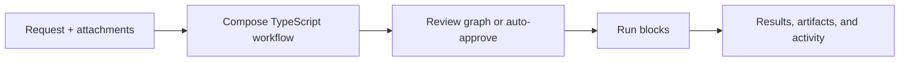

# Workflow

**Turn a coding request into a workflow you can inspect, run, and resume.**

Workflow is a local AI development tool with a browser workspace. Describe a task, attach files or screenshots, and the orchestrator composes a TypeScript workflow from your reusable blocks, task instructions, and model profiles. Review the graph, then start it—or enable automatic execution.

## Why this project exists

Finishing a coding task often takes several kinds of work: understand the request, implement it, write or run tests, review the result, address feedback, and sometimes commit and push. Workflow makes those responsibilities and their connections explicit.

- **Make the process visible.** See the proposed graph before execution, the blocks currently running, and the results and logs of each attempt.
- **Give different work to different models.** Describe model profiles for implementation, careful review, or routine work. Let the orchestrator assign them, or choose models in code.
- **Use code for predictable operations.** A test, build, or push can run directly without a model call. AI is a capability inside a TypeScript block.
- **Turn feedback into a controlled loop.** A test block returns diagnostics; an implementation block fixes the problem. Conditions, explicit outcomes, and visit limits decide what happens next.
- **Keep progress across interruptions.** Temporal records execution history. Completed work is retained, and interrupted attempts have an explicit recovery and retry path.

It is useful when you want a repeatable development process with autonomous execution and inspectable results. For a one-off question, there may be no reason to create a workflow.

## How it works



The coordinator uses the supplied request, context, task instructions, blocks, and model profiles. Repository inspection happens inside execution blocks. A task instruction such as “bug fix” describes how to approach that kind of work; it does not prescribe a fixed graph.

| Concept | What you define |
| --- | --- |
| **Block** | A reusable TypeScript function with optional AI calls, commands, inputs, and outputs. |
| **Workflow** | Steps composed into sequences, branches, parallel groups, and bounded loops. |
| **Task instructions and model profiles** | Guidance the orchestrator uses to choose blocks and models for a particular request. |

The web UI uses Vue, Vue Flow, CodeMirror, and Catppuccin Mocha. Pi provides embedded model sessions and authentication integration; Temporal provides durable execution. Workflow owns the task workspace, configuration, approval flow, and results. [Read the design rationale](docs/concepts.md) or [explore the architecture](docs/architecture.md).

## Get started

Requires **Bun 1.4.2+** and Bash. Git and your project's build/test tools must be available for blocks that use them. Workflow itself does not require a separate Node.js installation.

Install from this repository:

```sh
git clone https://github.com/cjvnjde/workflow.git
cd workflow
bun install --frozen-lockfile --ignore-scripts
bun run build
bun link
```

Then run it from the project you want to work on:

```sh
cd /path/to/your/project
workflow init --instructions "Preserve public APIs and use the existing test framework."
workflow
```

Open **http://127.0.0.1:4310**:

1. In **Settings → Providers & models**, connect ChatGPT or a provider API key.
2. Choose a project model and generate or edit **Model profiles**.
3. Create a **New task**, describe the desired result, and attach useful context.
4. Inspect the proposed graph and select **Approve & start**.
5. Follow the active blocks and open **Results** for the outcome, checks, and downloadable artifacts.

The current directory is the project; there is no project-path argument. `workflow init` can generate profiles if a provider is already connected; use `--no-ai` to initialize without a model request. Review is the default approval mode.

[The getting-started guide](docs/getting-started.md) covers running without a PATH installation, development mode, first-task examples, and setup troubleshooting.

## Workflows are TypeScript

Use `step`, `sequence`, `parallel`, `when`, and `repeatUntil` to compose ordinary code blocks. This complete example runs two independent checks and collects their results without calling a model:

```ts
import { workflow, block, step, sequence, parallel, z } from "workflow";

const check = block({
  input: z.object({ command: z.string() }),
  async run(ctx) {
    const result = await ctx.exec(ctx.input.command);
    const passed = result.exitCode === 0 && !result.timedOut;
    ctx.summary(result.output || (passed ? "Check passed." : "Check failed."));
    ctx.outcome(passed ? "pass" : "fail");
    return { passed, output: result.output };
  },
});

const tests = step("tests", check, { inputs: { command: "bun test" } });
const types = step("types", check, { inputs: { command: "bun run typecheck" } });
const report = step("report", block({
  input: z.object({ tests: z.string(), types: z.string() }),
  run(ctx) {
    ctx.artifact("tests.txt", ctx.input.tests);
    ctx.artifact("types.txt", ctx.input.types);
    return "Tests and typechecking passed.";
  },
}), {
  inputs: ctx => ({
    tests: ctx.output(tests)!.output,
    types: ctx.output(types)!.output,
  }),
});

export default workflow({
  name: "Verify project",
  flow: sequence(parallel([tests, types], { concurrency: 2 }), report),
});
```

Use commands available in your project. Parallel blocks share its working directory; checks that rewrite the same files should run in sequence.

Import the source through **New task → Use a TypeScript workflow**, or save it in your project and run `workflow run verify.ts` while its server is running. Inside a block, `ctx.ai({ prompt, model?, output? })` adds a model session with optional typed output.

For an implementation/review loop driven by `review.approved`, see [the composed workflow example](examples/composed.ts). The [workflow guide](docs/workflows.md) explains conditions, outcomes, typed handoffs, model overrides, and limits.

## Documentation

Start at **[docs/README.md](docs/README.md)** for reading paths and a complete index.

| I want to… | Read |
| --- | --- |
| Understand why Workflow exists and its core concepts | [Concepts and design](docs/concepts.md) |
| Install it and run my first task | [Getting started](docs/getting-started.md) |
| Write sequences, branches, parallel groups, and loops | [Writing workflows](docs/workflows.md) |
| Build reusable code and AI blocks | [Writing blocks](docs/blocks.md) |
| Configure models, task instructions, skills, and MCP | [Configuration](docs/configuration.md) |
| Understand statuses, retries, recovery, and backups | [Running and recovering workflows](docs/operations.md) |
| Use the CLI or local HTTP API | [Command and API reference](docs/reference.md) |
| Understand the implementation or contribute | [Architecture](docs/architecture.md) · [Development](docs/development.md) |

## Execution boundaries

Workflow is a **single-user local application**. AI tools and commands run with the server user's filesystem, environment, and network access. Approval controls when a workflow starts; it is not an OS sandbox. File-tool recovery covers managed writes, while shell commands, Git operations, and external effects need separate inspection before a retry.

One workflow executes per project at a time, with explicit parallelism inside it. Provider errors, failed checks, exhausted limits, and unsuccessful planning can still stop a task. [Operations and current limitations](docs/operations.md) explain what can be resumed and what must be corrected first.

## Develop Workflow

```sh
bun run dev        # live backend + Vite at http://127.0.0.1:5173
bun run test       # build + backend/integration tests
bun run test:e2e   # build + headless browser tests
```

`dev` and `start` use real AI. Paid/subscription integration testing is a separate opt-in command, `bun run test:live`. See [Development](docs/development.md) for prerequisites, focused checks, and live-test scenarios.
