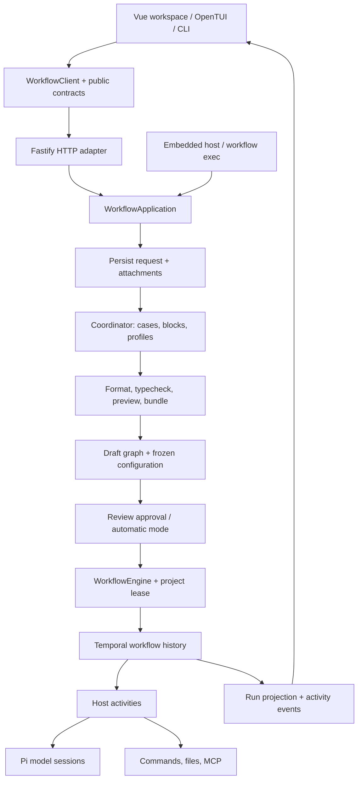

# Architecture

[Documentation](README.md) → Architecture

Workflow has a presentation-independent application layer around one execution engine. The browser and terminal clients share an HTTP client; embedded hosts and `workflow exec` call the application directly. TypeScript composition describes the work, Temporal records its progress, and host activities perform effects.

## Request to result

1. The task service saves the request, attachments, answers, and planning events.
2. The coordinator classifies the task, reads case instructions, selects described model profiles, and submits TypeScript. It has proposal tools, not repository inspection tools.
3. The compiler formats and typechecks the source, bundles static imports, and describes its declared composition. Invalid submissions return useful errors to the coordinator for correction.
4. The engine persists the draft with source, block catalog, model settings, configuration, and an executable version. Graph layout is a view of that structure.
5. Approval records a recoverable start intent and starts Temporal under the selected version. Activities must match the locally approved execution snapshot.
6. The workflow interpreter schedules steps and groups. Blocks execute pure code in the replayable runtime and request host effects through recorded activity boundaries.
7. Checkpoints update the local projection; activity events and live text reach the browser through SSE. Typed results and readable artifacts remain attached to attempts.

Shared `defineTool()` operations can be invoked by code through `ctx.call()` or explicitly offered to `ctx.ai()`. Their compiled module and imports are archived with the approved Temporal version. A bounded worker executes each tool through a host environment, recording its calls and child effects as structured events before execution. Read-only tools permit limited automatic retries; unsafe effects retain explicit recovery. AI sessions still recover as whole activities, not individual turns. See [shared tools](tools.md).

## Application and presentation boundaries

`createApplication` owns initialization, the project lease, tasks, design sessions, provider interactions, planning concurrency/cancellation, and shutdown. `WorkflowEngine` retains execution, approval, and recovery. Neither starts HTTP or loads GUI assets.

`createHttpServer` borrows that application and translates HTTP requests, headers, disconnects, and SSE. Closing this adapter closes its connections but leaves the application running. The host closes the application explicitly. `registerWebGui` optionally adds static browser assets. The legacy `createServer` wrapper keeps its combined ownership for existing callers.

The Vue code imports only the public `contracts` and `client` entry points from the backend tree. The shared client handles validation, revision headers, errors, endpoint selection, and event streaming. Presentation state, graph layout, editors, and rendering remain in `web/`. [Engine and clients](clients.md) documents the integration and lifecycle contract.

The terminal controller also uses only that client and public contracts. `src/tui/view.ts` renders its state with OpenTUI; `presentation.ts` formats activity and composition trees. `src/tui.ts` owns attachment or local application startup, signals, parser resources, and terminal cleanup. The CLI loads `dist/tui.js` only when requested, keeping native rendering out of server and scripting commands.

## Why Pi is embedded

Pi supplies model/provider integration, tool sessions, authentication integration, and terminal UI components. Workflow chooses which tools/resources a session gets, where credentials live, and how its result connects to the workflow.

Users set up connections through Workflow Settings. There is no separate Pi project to operate. Ambient Pi credentials, extensions, histories, and resource discovery are not automatically imported. The task coordinator, settings designers, and execution sessions have different roles and tool sets.

## Why Temporal owns execution

Durable routing requires more than saving the latest graph node in JSON. The runtime needs the recorded order and results of operations, signals, active attempts, and state transitions after a restart.

Temporal owns that history. Deterministic workflow code composes steps, applies visit limits, processes pause/resume, and waits for activity results. Host activities run model sessions, commands, and filesystem operations. Mutating activities do not get automatic retries; interrupted work waits for an explicit retry decision.

Local JSON is the approval record and UI projection, not an alternative executor. The managed Temporal development service uses project-local SQLite and binds to loopback. An external endpoint can be selected, but hosted deployment and remote authentication onboarding are separate work.

## Composition and execution

The SDK builds a tree of `step`, `sequence`, `parallel`, `when`, and `repeatUntil` nodes. `describeFlow` serializes the structure for preview without calling its blocks, input callbacks, or conditions. The compiler evaluates declarative module initialization in a bounded VM without host APIs. Imperative workflows retain execution-only initialization.

At execution, the runtime checks that the structure matches the reviewed one, then interprets it. Deferred inputs and conditions read completed typed results. Parallel branches have separate result views until the join, with a global eight-step admission cap and explicit group concurrency.

Each host operation is tied to its exact step and visit rather than a single mutable cursor. Managed write claims prevent parallel attempts from changing the same tracked path. Spending-limited AI sessions serialize against the remaining balance. These mechanisms preserve the existing recovery/budget contracts while allowing explicit parallel work.

## Frozen and live data

| Captured with a draft | Read or used during execution |
| --- | --- |
| Workflow source and bundled static imports | Project files inspected by blocks |
| Reusable block source and explicit resources | Scripts launched through `ctx.exec` |
| Model profiles and resolved configuration | Credentials/provider access for actual requests |
| Commands, limits, attachments, and graph structure | Command environment and external service state |

A saved workflow version contains its bundled deterministic code and SDK manifest. Active executions use that archive across compatible application upgrades. Host activity compatibility still matters; version archives are not arbitrary runtime migration machinery.

## Persistence and trust

The project lease prevents competing Workflow servers from owning the same project. A run's approval snapshot and Temporal identity are checked at activity boundaries. Revision checks protect draft/settings edits from stale browser writes. Version hashes protect archive integrity.

These are execution consistency measures. AI and command tools still use the server user's local access. File journals recover managed writes; they cannot reverse arbitrary shell, Git, or remote effects. The HTTP server has local host/origin and mutation-header guards, but no remote multi-user authentication.

[Operations](operations.md) documents recovery semantics and the backup boundary.

## Source map

Paths below are relative to the repository checkout. The packaged CLI includes compiled artifacts rather than the source tree.

| Area | Main files |
| --- | --- |
| Application and lifecycle | `src/application.ts` |
| CLI and local HTTP | `src/cli.ts`, `src/terminal-client.ts`, `src/http-server.ts` |
| Terminal workspace | `src/tui.ts`, `src/tui/controller.ts`, `src/tui/view.ts`, `src/tui/presentation.ts` |
| Client contract and transport | `src/contracts.ts`, `src/client.ts` |
| Optional GUI serving / compatibility | `src/web-server.ts`, `src/server.ts` |
| Task persistence and planning | `src/tasks.ts`, `src/task-planner.ts`, `src/task-schema.ts` |
| Public authoring API | `src/workflow-sdk.ts`, `src/composition-sdk.ts` |
| Source validation and preview | `src/program-compiler.ts`, `src/composition-plan.ts`, `src/source-format.ts` |
| Durable execution | `src/engine.ts`, `src/temporal-workflow.ts`, `src/composition-runtime.ts` |
| Code blocks and host effects | `src/code-runtime.ts`, `src/code-host.ts`, `src/block-runner.ts` |
| Shared tools and environments | `src/tool-sdk.ts`, `src/tool-runner.ts`, `src/tool-worker.ts`, `src/execution-environment.ts`, `src/operation-schema.ts` |
| Models and sessions | `src/agent-session.ts`, `src/model-runtime.ts`, `src/available-models.ts` |
| Auth and user defaults | `src/browser-auth.ts`, `src/user-settings.ts`, `src/terminal-commands.ts` |
| Library and settings design | `src/library.ts`, `src/library-proposals.ts`, `src/design-chats.ts`, `src/settings-designer.ts` |
| Recovery and persistence | `src/recovery.ts`, `src/workspace.ts`, `src/run-store.ts`, `src/attempt-store.ts` |
| Temporal process/version management | `src/temporal-server.ts`, `src/temporal-runtime.ts`, `src/workflow-versions.ts`, `src/project-lock.ts` |
| Vue state and navigation | `web/App.vue`, `web/composables/` |
| Graph, activity, results, editors | `web/components/`, `web/graph-layout.ts` |
| Settings UI | `web/settings/` |
| Build, development, live checks | `scripts/` |
| Unit, integration, recovery, browser tests | `tests/`, `tests/e2e/` |

The frozen legacy workflow bundle is retained under `src/legacy/` for replay compatibility. New features should not silently rewrite historical execution behavior.

[Next: development and testing](development.md)
