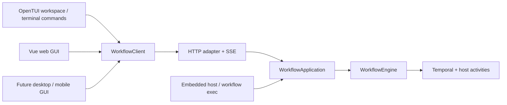

# Engine and clients

[Documentation](README.md) → Engine and clients

Workflow has one application layer and several ways to use it. The application owns task planning, configuration, attachments, provider sessions, execution, and persistence. Presentation code chooses how to display and control that state.



The web GUI and [OpenTUI terminal workspace](terminal.md) use these boundaries today. Desktop and mobile GUIs can be built against the same interfaces.

`workflow` (also `workflow start` or `workflow tui`) opens the interactive terminal workspace and attaches to the project's existing server when available, otherwise starting a detached background host. Use `workflow tui --server URL` to select a remote engine. The terminal guide explains ownership, session controls, approval, and login.

## Run without a GUI

From an initialized project:

```sh
# Executes the file, waits, prints its final state, and shuts down the worker.
workflow exec verify.ts

# JSON result for scripts; input is passed to the authored workflow.
workflow exec verify.ts --input '{"request":"Check the project"}' --json
```

`exec` explicitly authorizes execution of the supplied workflow. It starts the application and Temporal worker without an HTTP listener or web assets. Completed results remain in `.workflow/`. Do not run it alongside another engine owning that project; the existing project lease prevents that.

Exit codes for `exec`, `watch`, and `--wait`: **0** completed, **1** failed/cancelled or a command error, **2** draft/paused/interrupted and needs attention. Interrupting `exec` shuts down its worker; it does not discard history. Start `workflow serve --no-web`, inspect the run, and explicitly resume or cancel it. Interrupting `watch` only stops the client; the server keeps running.

## Keep the engine running

```sh
# Start once; the command returns after readiness is verified.
workflow start --background
workflow status

# Or start API and worker without browser assets.
workflow start --background --no-web

# In another terminal:
workflow run verify.ts
workflow runs
workflow show <run-id>
workflow approve <run-id> --wait
workflow events <run-id>
workflow pause <run-id>
workflow resume <run-id> --wait

# Request-driven planning also works from the terminal:
workflow task "Review the project and report actionable findings"
workflow tasks
workflow task-show <task-id>
workflow answer <task-id> "Answer to the planner's question"
```

Task planning uses the project's approval setting, just like the web GUI. `task-show` exposes the linked run ID, planning failures, and any question. Inspect a review-mode draft with `show` and start it with `approve`. CLI control commands accept `--json` for machine-readable responses. `workflow run verify.ts --approve --wait` combines import, explicit approval, and waiting.

Bare `workflow` is equivalent to `workflow start`: both open the TUI. Use `workflow --background` for a detached start that returns immediately, or `workflow --background --web` to also open the browser. These hosts stay running after the starter, TUI, and browser close. Repeated startup reuses the same project and mode, including a discovered ephemeral port. Startup JSON requires `--background --json`. Use `workflow stop` to drain the worker and stop its managed Temporal process; saved tasks and runs remain. Start again in the same mode and explicitly resume interrupted work.

`workflow --web` opens the browser UI after readiness and runs a new host in the foreground until Ctrl+C or `workflow stop`; if a host already exists, it opens that host’s UI and returns. `workflow serve` runs the same foreground host without opening a browser. It is useful for development and external process supervisors. `--no-web` omits browser assets in either hosting mode. The HTTP routes, revisions, concurrency guards, and event format remain shared.

Host status and startup failures are available through `workflow status --json` and `.workflow/host.log`. Startup captures the caller's environment; stop and start the host to apply changed environment variables. Background hosting is local process detachment, not automatic restart after a crash or machine reboot.

## A server on another machine

Run `workflow start --background --no-web` in the project on that machine. The API remains loopback-only and single-user. A terminal client can select an explicit endpoint, for example through an SSH tunnel:

```sh
ssh -L 4312:127.0.0.1:4310 your-server
workflow runs --server http://127.0.0.1:4312
workflow tui --server http://127.0.0.1:4312
workflow show <run-id> --server http://127.0.0.1:4312
```

`--server` deliberately selects the endpoint's project; it skips the usual check that the server project matches the client's current directory. `run` still reads its source from the client's current project. Relative module imports are resolved on the engine machine, so referenced files must exist there too.

There is no public multi-user authentication or CORS configuration in this refactor. Keep the API on loopback, or place a deployment-specific authenticated proxy in front of it. A browser deployment should serve the GUI and proxy `/api/` on the same origin; the proxy must preserve the engine's host/origin guards. The GUI's optional `VITE_WORKFLOW_API_URL` build setting supports an API proxy prefix and is used for requests, event streams, and attachment links. An arbitrary cross-origin URL alone does not enable CORS.

## Embed the application

The installed package exports `predictable-workflow/core`, `/web`, and `/terminal`, plus the shared `/client`, `/contracts`, and authoring SDK `/workflow`. The original `/engine` and `/http` exports remain compatible.

| Module     | Responsibility                                                                                         |
| ---------- | ------------------------------------------------------------------------------------------------------ |
| `core`     | Application services, model planning, execution, storage, approval, recovery. No HTTP listener or GUI. |
| `web`      | HTTP/SSE adapter and optional static browser GUI. Borrows an application.                              |
| `terminal` | Terminal presentation and host attachment. Shares the same HTTP client as the browser.                 |

They are explicit module entry points within one distributable package, not independently versioned packages. Implementation files remain compatible with existing source imports.

```ts
import { createApplication } from "predictable-workflow/core";
import { waitForRun } from "predictable-workflow/client";

const app = await createApplication({ project: process.cwd() });
try {
  const draft = await app.createProgram({
    title: "Verify",
    task: "Run the checks",
    filename: "verify.ts",
    source: await Bun.file("verify.ts").text(),
    input: {},
  });
  const unsubscribe = app.subscribe((event) => console.log(event.kind, event.message));
  try {
    await app.approve(draft.id, draft.revision);
    console.log(await waitForRun(() => app.getRun(draft.id)));
  } finally {
    unsubscribe();
  }
} finally {
  await app.close();
}
```

Initialize project configuration first with `workflow init`. `createApplication` takes optional model/planner service overrides, a block runner, execution mode, and Temporal options. It owns the project lease and cleans up failed startup. `close()` is idempotent, aborts and drains coordinator work, closes task/design services, and shuts down the engine. Subscribe once per presentation and unsubscribe when it closes. Events are live hints; read runs/tasks and persisted events for authoritative state.

Run events reach subscribers after their event-log write succeeds. Streamed `text_delta` events remain ephemeral but keep their order relative to saved run events; coordinator notifications remain live hints. Event reads, mutations that flush events, and shutdown also drain queued run notifications. Each subscriber receives its own event copy. A subscriber that throws or rejects is logged without failing execution or preventing delivery to other subscribers; the engine does not wait for asynchronous subscriber work.

An embedded host may attach HTTP separately:

```ts
import { createHttpServer } from "predictable-workflow/web";

const http = await createHttpServer(app, 4310);
await http.listen({ port: 4310, host: "127.0.0.1" });
// Later: stop requests/events without shutting down the application.
await http.close();
```

The host still owns `app.close()`. The old source-level `createServer(engine)` convenience entry point retains its original behavior: it attaches the application, API, and GUI and closes the engine with the server.

## Build another presentation

```ts
import { WorkflowClient } from "predictable-workflow/client";

const client = new WorkflowClient({ baseUrl: "http://127.0.0.1:4310" });
const runs = await client.runs();
const subscription = client.subscribe((event) => console.log(event), {
  onOpen: () => {
    void client.runs().then(console.log);
  },
});
// On teardown:
subscription.close();
await subscription.done;
```

`WorkflowClient` uses Fetch, readable streams, and AbortSignal, with no Vue, DOM, Node, or Temporal dependency. Native runtimes without Fetch streaming can provide a compatible `fetch` implementation or poll the HTTP API. It shares response validation, errors, revision headers, and SSE reconnect behavior. `request(route, schema, options)` covers the rest of the API, including settings, authentication, and design conversations. `headers` can carry deployment-specific proxy credentials. Do not put credentials in URLs.

Import types and validation schemas from `/contracts`, not application internals. `stream()` exposes one event connection as an async iterator; `subscribe()` reconnects automatically. Reload persisted state in `onOpen` because the stream does not replay missed events. `waitForRun()` works with both an embedded application and an HTTP client.

Structured tool events include `event.operation` with call and parent IDs, lifecycle state, typed evidence and duration. Render these fields directly; older events retain their text format. Embedded hosts can supply a shared-tool execution environment through `createApplication({ environment })`. See [shared tools](tools.md) for the contract and recovery limits.

## Build separately

```sh
bun run build:engine   # CLI/TUI, application, HTTP/client/contracts, SDK and Temporal bundles
bun run build:web      # only dist/web; leaves engine artifacts alone
bun run build          # full build, including typechecking
```

An engine-only build does not invoke Vite and preserves existing `dist/web` if present. Typechecking still checks the whole repository. The core application does not import a GUI; the CLI loads the native OpenTUI renderer for the default workspace, `tui`, or `attach`. The repository's single package still lists presentation dependencies, so this is not yet a separately published minimal backend package.
