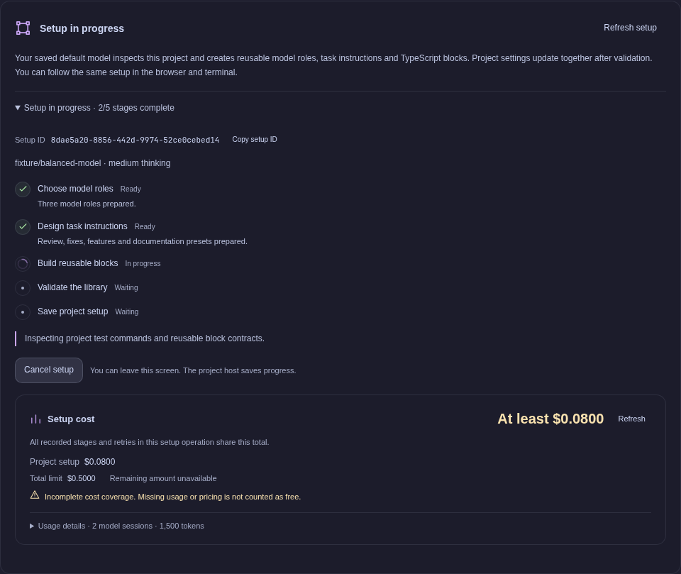

# Configuration

[Documentation](README.md) → Configuration

All routine setup is available under **Settings**. Changes apply to future proposals; existing drafts and runs keep their captured configuration. To change a draft, edit or refine that draft explicitly.

## Settings sections

| Section | Use it for |
| --- | --- |
| **Providers & models** | ChatGPT sign-in, provider API keys, connection status, and project defaults. |
| **Model profiles** | Described model choices for planning and execution roles. |
| **Task instructions** | Shared planning guidance and editable cases such as bug, feature, or investigation. |
| **Blocks** | Reusable TypeScript functions, prompts, model calls, checks, and outputs. |
| **Skills & MCP** | Explicit instruction resources and enabled tool servers. |
| **Execution** | Approval mode, project instructions, total steps, spending limits, and named commands. |

Unsaved forms have discard/cancel controls. Saves carry revisions, so a stale browser cannot silently overwrite newer settings. Save or discard form changes before applying an AI proposal.

## Providers and defaults

Workflow supports ChatGPT account sign-in and API keys for other providers. Connected accounts show their status instead of another sign-in button. The external authentication callback page is provided by the embedded authentication integration; return to Workflow afterward.

Refresh connections and models after connecting or changing credentials. The catalog reflects the configured providers, but the provider ultimately decides whether an individual model request is accepted. A subscription connection and an API key can expose different models.

**Use shared defaults** clears project model overrides. Shared settings can also be changed through optional terminal commands such as `workflow model` and `workflow thinking`. Provider changes do not imply a compatible replacement model; select the intended model from the refreshed catalog.

For precedence through profiles, steps, and explicit `ctx.ai` calls, see [Model selection](blocks.md#ai-and-model-selection).

## Model profiles

A profile has an ID, name, description, provider, model, thinking level, and enabled flag. Its description tells the coordinator when to choose it, for example:

| Profile role | Useful description |
| --- | --- |
| Implementer | “Use for routine changes in this TypeScript project; follow existing patterns and write focused tests.” |
| Reviewer | “Use for independent review of consequential changes, concurrency, and persistence.” |
| Summarizer | “Use for short reports and mechanical text work.” |

Several profiles can use the same model with different roles or thinking levels. A planning profile can be selected in Settings; users do not choose a coordinator for every task. Profiles available to execution are captured as `ctx.models[profileId]` when a workflow is created.

Use `workflow setup` for a complete project bootstrap, or **Generate with AI** / **Regenerate with AI** for a reviewable profile design conversation. `workflow profiles --instructions "..."` explicitly regenerates only profiles. `workflow init` and ordinary application startup never make setup model requests.

Planning uses your configured project/shared default model and thinking level. An explicit coordinator or coordinator profile overrides it. Changing the default no longer silently selects a different model. If no model has ever been configured, the planner can choose an available fallback; explicit `workflow setup` asks you to select a default first. Model profile cards are configured roles, not the connected provider's full catalog.

Setup refreshes the connected catalog and requests current, task-appropriate profiles: inexpensive models for routine work, suitable coding models for implementation, and stronger reasoning where justified. It does not invent unavailable model IDs. OpenAI's current family includes GPT-6.1 Sol/Terra and GPT-6 Astra/Luna; actual provider/account access and cached catalogs may differ. [Official model catalog](https://developers.openai.com/api/docs/models/all).

`workflow setup --model provider/model-id --thinking medium` freezes that choice for the setup job and saves it as the project default when setup succeeds. `workflow model` changes the shared user default instead. A completed setup is recorded in `.workflow/setup.json`; use `--regenerate` to intentionally redesign the library. Existing runs keep their approved snapshots.

The setup panel in Settings and `/setup` in the terminal attach to the same saved core job. Generation checkpoints each accepted stage, then publishes the validated profiles, instructions and blocks together. Resume an unfinished job to retain completed stages and the same setup spending limit. Regeneration creates a new job; a failed regeneration does not remove the previously published setup. Unsaved form changes remain yours to reconcile after setup updates the saved settings.



This capture uses a test provider and simulated usage to demonstrate saved progress and cost reporting.

## Task instructions

Cases contain a description and instructions, not a graph. The coordinator chooses a relevant enabled case, reads its instructions, then composes blocks for the specific request. Add, edit, disable, or remove cases as your process changes.

An example maintenance case might say:

> Preserve existing behavior unless the request explicitly changes it. Select validation appropriate to the affected code. Use a command block for mechanical verification, return diagnostics to implementation, and request independent review for consequential changes.

Use shared planning instructions for project-wide preferences. **Execution → Project instructions** supplies project constraints to execution. The coordinator also sees those constraints when planning. Avoid assuming that a case name alone supplies its intended behavior: make the instructions concrete.

The **suggest blocks** setting allows the planner to propose missing reusable roles. Proposed blocks stay local to that task until explicitly saved to the library.

## Design settings with AI

**Design with AI** is available in the top bar on every page. Floating conversations, drafts and proposals survive navigation and reloads. The global button is the single general design entry point; every conversation can inspect and propose changes across settings sections. Each message records its page, active settings section, selected block and current task/run IDs. Describe what you want, add constraints, refine the proposal, and select **Apply changes** when satisfied. A message can ask for an explanation without requiring an immediate edit.

Chats can be moved, resized, minimized, and restored. **New conversation** creates another window rather than replacing the existing one. Conversation history, proposals, and window state persist. **Stop**, **Discard message**, and **Discard proposal** have different scopes; none applies an unfinished proposal.

The designer uses a shared internal tool interface with named operations and JSON schemas: `workflow_inspect` reads configuration, models, blocks, tasks, runs and events; `propose_settings` validates a reviewable change; `reply_to_user` answers questions. This is an MCP-style internal interface, not an externally exposed MCP server. Inspection supports field selection and pagination. File inspection is read-only; the designer does not have shell or file-edit tools. Proposals retain revision checks and apply through the existing settings services. One section can be proposed per turn; after applying, continue in the same chat for another section. Changes affect future runs, while existing runs retain their frozen configuration. Provider credentials and automatic approval remain user-controlled.

Settings designers can inspect the project through tools to inform configuration. This is different from the task coordinator, which composes its graph only from supplied context. Applying settings does not silently approve a task or change provider credentials. Stale proposals are rejected when the underlying section has changed.

## Skills and MCP

Workflow discovers project skills from `.agents/skills`, `.claude/skills`, `.codex/skills`, and `.pi/skills` (in that precedence order). It reads `SKILL.md` metadata and instructions, preserving the source directory for referenced resources. Skills marked `disable-model-invocation` remain disabled. Settings shows discovered source paths; edit those files to update them.

Skills are instruction resources with names, descriptions, and content. Enable those relevant to your project. They provide guidance, not executable permission boundaries. Block-specific resource files can also be captured with a block.

MCP definitions are discovered from `.mcp.json` (`mcpServers`), `.codex/config.toml` (`mcp_servers`), `.vscode/mcp.json` (`servers`), and `.pi/mcp.json` (`mcpServers`), in that order. Disabled definitions remain disabled. `${workspaceFolder}` is resolved in local commands and arguments. JSON must be strict JSON. HTTP `bearer_token_env_var` references are supported; literal `env` values and custom headers are not imported and produce a visible diagnostic instead of copying credentials into run snapshots. Local servers inherit Workflow’s environment.

Project discovery does not start servers. New tasks resolve and freeze capabilities; existing runs retain their snapshot. Manually configured entries with the same ID override discovered entries, including disabled overrides. Discovery is project-local and does not import global agent configuration or arbitrary extensions.

MCP servers support HTTP and local stdio transports. Configure an endpoint or command/arguments, inspect its tools, and enable it. Enabled servers expose their discovered tools to execution sessions. The task graph coordinator never invokes MCP tools.

For an HTTP bearer token, `tokenEnv` names a server-process environment variable; do not put the secret in the endpoint URL. Local stdio servers run in the project and inherit the application's environment. This is explicit project configuration, not automatic discovery of arbitrary Pi extensions or support for every MCP authentication scheme.

## Execution limits and costs

Review approval is the default. **Automatic** mode starts an accepted plan without a review click, including its task-local blocks. If another workflow owns the project, the task remains available with an explanation rather than silently starting a competing run.

The total step limit defaults to 30 and can be set from 1 to 500. Per-step visits, loop iterations, block time/operation limits, and model time/tool-call limits also apply. Choose bounds that allow the intended feedback loop while preventing indefinite work.

The usage panel shows reported planning, setup, settings design, refinement, and execution costs, including failed attempts, provider retries, and compaction. Expand it for phase/model totals and individual model sessions. Settings shows the project lifetime total; a task or workflow shows its shared task scope. Recovery tasks retain their original scope and spending. `workflow usage [task-or-run-id] --json` exposes the same report.

Three optional limits are available in **Execution**:

| Configuration field | Coverage |
| --- | --- |
| `budget.maxCostUsd` | Execution only for each run; existing frozen run limits keep this meaning. |
| `budget.maxTaskCostUsd` | Planning, clarification, refinement, execution, and retries for a task or direct workflow. |
| `budget.maxSetupCostUsd` | All stages of one setup generation. |

Limits are captured when work starts. `workflow task "Request" --max-task-cost 2` and `workflow setup --max-setup-cost 1` override the corresponding project default for new work. Retrying or answering a task does not reset its total. Settings design and standalone library generation are accounted for in the project total but do not inherit a task or setup limit.

Prices come from configured overrides or the connected model catalog; every session saves its pricing source. Unknown prices remain unknown, and budgeted model calls require known pricing. Model sessions sharing a total limit serialize so parallel branches cannot spend the same remaining balance. Limits stop later work and can abort sessions after reported usage reaches the threshold; a response already in flight can exceed it. The ledger retains the actual reported amount, including any overshoot.

Cost estimates are planning aids, not a bill or a measure of subscription quota. TypeScript blocks choose AI calls and models at runtime, so their draft estimate is unknown rather than zero. Deterministic command executors have no model cost. Older execution records and custom-runner usage are included once; unavailable historical planning costs, missing pricing, and interrupted/in-flight reporting are shown as incomplete. Command costs, external service charges, and unreported provider charges are not calculated.

## Named checks

Named commands make a common check available through `run_check`. New code blocks can also invoke any command directly through `ctx.exec`; no registry entry is needed for every operation.

An example `.workflow/config.json` with inherited model defaults:

```json
{
  "version": 1,
  "instructions": "Use focused tests and preserve public APIs.",
  "agent": {},
  "commands": {
    "test": { "argv": ["bun", "run", "test"], "timeoutMs": 120000 }
  },
  "maxSteps": 30,
  "recovery": { "rollbackOnFailure": true }
}
```

Named commands use argument arrays without shell interpolation. Code blocks interpret `ctx.exec` results themselves. Older agent definitions can have host checks that override an agent's claimed pass when the actual command fails. Test results should guide implementation rather than cause verification to weaken tests.

## Where settings live

| Location | Contents |
| --- | --- |
| `.workflow/config.json` | Project instructions, model/coordinator defaults, commands, limits, recovery. |
| `.workflow/orchestration.json` | Profiles, task cases, shared planning instructions, skills/MCP, approval preferences. |
| `.workflow/blocks/<id>/block.ts` | Editable TypeScript block source; generated setup and UI-applied code are written here. |
| `.workflow/library.json` | Active block metadata, source-file references, and a recoverable inline snapshot. |
| `.workflow/setup.json` | Completed bootstrap marker and the model used for setup. |
| `.workflow/server.json` | Private running-host discovery receipt; not reusable project configuration. |
| `.workflow/libraries/` | Prior library snapshots. |
| `.workflow/design-chats/` | Private settings conversations and proposals. |
| `.workflow/usage/` | Private durable model-session usage, pricing, and task/setup ownership; retained when history entries are removed. |

Reusable project configuration can be version controlled. Generated runs, tasks, attachments, conversations, journals, and Temporal state are private runtime data; initialization adds ignore rules for them. [Operations](operations.md#persistence-and-backups) lists what to back up.

For libraries with `sourceFiles` in the manifest, `block.ts` is authoritative: editing it changes the next loaded library and invalidates stale proposals. Approved runs retain their frozen source. Missing referenced files fail explicitly. Old inline-only manifests remain readable and gain editable source files on the next Apply/setup. During publication, the complete inline snapshot stays active until all source files are written; interrupted publication can be reapplied without silently overwriting later manual edits.

User settings live outside projects in `$XDG_CONFIG_HOME/workflow` when the XDG path is absolute, otherwise `~/.config/workflow`. `WORKFLOW_HOME` overrides this location:

| File | Purpose |
| --- | --- |
| `auth.json` | API keys/OAuth credentials managed by the embedded SDK. |
| `settings.json` | Shared defaults and device identity. |
| `models.json` | Optional advanced custom-provider configuration. |
| `model-catalog.json` | Cached model catalog. |
| `cache/temporal/` | Managed Temporal executable. |

Credential files use private filesystem permissions, not an OS keychain. API auth responses expose connection status and prompts, not credential objects. Disconnect removes saved local credentials; it does not revoke them at the provider. Workflow does not import Pi's credentials or ambient project/global extensions.

## Execution evidence and ownership

Results shows actual step attempt durations and overlaps, AI working directories, before/after file changes, and verified ownership checks. Missing scans are explicitly unavailable, not evidence that nothing changed. Concurrent shared-workspace changes cannot be attributed to a single writer. File scans exclude runtime/dependency trees and cannot detect transient edits restored before a check; they are integrity evidence, not an OS sandbox.

`ctx.ai({ writablePaths: ["tests/**"] })` protects all other project paths. An empty allowlist is read-only. `protectedPaths` still wins if both are provided. Managed writes are blocked before editing; shell/MCP changes are detected between tools and before acceptance. New default test-authoring blocks use test-only allowlists. Existing saved libraries and run snapshots are not silently rewritten.

Use `ctx.disposition("work-completed")` for authoring, `"accepted"` for verified acceptance, `"changes-requested"` for defects, and `"blocked"` for unavailable prerequisites. These also set pass/pass/retry/fail respectively. A successful authoring result does not establish acceptance.

## Parallel implementation

AI calls can select an existing sibling Git worktree with `ctx.ai({workspace: worktreePath, ...})`. The host validates that it belongs to the same repository. Guarded writers require exclusive ownership of their execution worktree, including the primary checkout; guarded read-only calls may share it. Disjoint write allowlists do not make shared-checkout writers safe, because each allowlist protects the other writer's files. Statically known conflicts are rejected during composition validation; dynamic workspaces are checked before execution. Existing unguarded calls in the primary checkout retain their legacy concurrency behavior and are not a safe substitute for isolated writers. File tools, commands, MCP roots, and integrity checks use that directory. Managed edits are journaled with absolute paths so recovery targets the correct checkout. Managed writes outside an isolated worktree are rejected; shell/MCP are not OS-sandboxed.

The workflow must create distinct worktrees from a recorded common baseline, preserve relevant uncommitted work, and explicitly integrate changes after joining writers. Integration conflicts must stop acceptance until resolved. Run combined checks after integration; per-branch checks are insufficient. Worktrees are retained until an explicit cleanup step, preserving evidence when integration fails.

## Continuing failed work

**Plan recovery with prior evidence** creates a new reviewed task for a failed or cancelled run. It retains the original request, clarification answers, attachments, prior results and diagnostics. The coordinator must arrange read-only validation of the current workspace before reusing evidence or proposing remaining repairs. It does not automatically replay effects, skip checks, or rewrite the old run. The new workflow uses the current runtime and always requires approval, even when ordinary tasks use automatic execution. Paused/interrupted runs retain their existing resume mechanism.

If file recovery reports a conflict, stop execution first. **Keep current files** retains the current bytes and releases resolved claims without accepting the implementation. Alternatively, restore the intended baseline and use **Retry file recovery**. Continuation planning requires resolving these conflicts first. Model-session and code-block timeouts are separate limits; a longer block budget does not implicitly increase the inner model limit.

Large AI handoffs (over 32,000 characters, up to 256,000) are retained losslessly under the attempt directory. The model receives ordered context-file references with a SHA-256 fingerprint and must read all parts before acting. Parts fit the file reader's output limit, including long single-line JSON. The original prompt remains available in full; no diagnostic tail is silently discarded. Keep composed handoffs focused rather than repeatedly nesting full prior results alongside their duplicated typed outputs.
