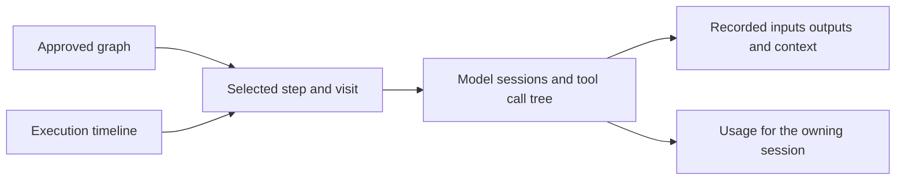

# DeepSeek Harness ideas for Workflow

Reviewed on 2026-10-30 against Workflow commit `30d8f17fdc9b73bed4850a18f728b732a72040ea` and DeepSeek Harness commit [`ce7073d51254c26cd63b22a60835b8f948deb447`](https://github.com/deepseek-ai/deepseek-harness/tree/ce7073d51254c26cd63b22a60835b8f948deb447). This is a source and documentation assessment, with the existing Workflow workspace screenshot as visual context; it is not a runtime benchmark. The comparison below describes that baseline.

Implementation follow-up: the operation projection, paged history, timeline, result cards, retained command output, request/compaction tracing, environment routing, and opt-in parallel reads are now implemented. See [Inspecting execution](execution-inspection.md) for current behavior and limits. The deliberately deferred ideas below remain deferred; the comparison is retained as the rationale rather than rewritten as a description of the new implementation.

**Adopt Harness's approach to inspecting execution, then selectively adopt its extension boundaries. Keep Workflow's approved TypeScript compositions, Pi integration, and Temporal execution.**

The closest match to the tool calls and time diagram you like is Harness's **Tool call tree** and **Trajectory** view. Their value comes from connecting a readable action, its lifecycle, nested work, timing, and evidence. Workflow already records much of the necessary information. Making that information connected and easy to explore is the best first investment.

## How the two projects fit together

Workflow's maintained vision is in [Concepts and design](concepts.md), [Architecture](architecture.md), and [Project review](project-review.md). The old [implementation plan](implementation-plan.md) explicitly redirects to those documents; it is not a separate roadmap.

That vision has several important commitments: the coordinator composes a reviewable process; blocks combine ordinary code and fresh AI sessions; typed outputs control handoffs; different work can use different models; execution survives interruptions; and browser and terminal clients share one engine. Optional memory captures useful guidance without starting extra model jobs.

Harness takes a broader agent-platform approach. Cordis plugins provide the agent loop, tools, model adapters, persistence, policy, and UI. A deployment chooses a composition of those capabilities. Its session log supplies durable facts from which model history and inspection surfaces are derived. Its tool UI and Trajectory view expose what happened inside an agent's work. [Harness architecture][h-architecture]

| Dimension             | Workflow today                                                             | Harness at the reviewed revision                                                  | Implication                                                                      |
| --------------------- | -------------------------------------------------------------------------- | --------------------------------------------------------------------------------- | -------------------------------------------------------------------------------- |
| Primary abstraction   | Task → approved workflow → steps and visits                                | Agent session → turns, model requests, and tools                                  | Use Harness's inspection ideas inside our steps.                                 |
| Orchestration         | Declared TypeScript sequences, parallel groups, conditions, bounded loops  | Includes a model-facing JavaScript workflow tool that coordinates subagents       | Similar intent, different execution guarantees.                                  |
| Recovery              | Temporal history, frozen versions, explicit recovery for uncertain effects | Session persistence; its workflow scripts explicitly have no journaling or resume | Retain our workflow executor.                                                    |
| Extensibility         | Blocks, shared tools, skills, MCP, injected application dependencies       | Cordis services, events, scopes, plugins, and UI slots                            | Borrow narrow interfaces before adopting a plugin framework.                     |
| Inspection            | Graph, activity, results, Data inspector, usage                            | Tool-specific cards, nested call trees, Trajectory ledger and timing overview     | Largest immediate product opportunity.                                           |
| Context               | Fresh AI sessions and selected typed handoffs; saved context evidence      | Session-derived history, pruning, compaction, spill storage                       | Improve within-session visibility while preserving explicit cross-step handoffs. |
| Execution environment | Local tools; shared tools have an injectable environment                   | Filesystem, subprocess, shell, sandbox, and remote provider boundaries            | Useful longer-term architecture reference.                                       |

Sources: [Workflow concepts](concepts.md), [shared tools](tools.md), [Harness architecture][h-architecture], [Harness workflow contract][h-workflow], [Harness tool UI][h-tool-ui], and [Trajectory][h-trajectory].

## What we already have

This is an extension of existing work, not a request to recreate observability from scratch.

| Existing foundation         | Evidence in our source                                                                                                                                                                                     | Remaining gap                                                                                     |
| --------------------------- | ---------------------------------------------------------------------------------------------------------------------------------------------------------------------------------------------------------- | ------------------------------------------------------------------------------------------------- |
| Structured operations       | [operation-schema.ts](../src/contracts/operation-schema.ts) includes IDs, parent IDs, states, input/output/details, durations, retry attempt, and replay metadata.                                         | One coherent call model that combines lifecycle records and preserves retry identity.             |
| Nested tool evidence        | [agent-session.ts](../src/core/models/agent-session.ts) connects model tools to their AI operation; [tool-runner.ts](../src/core/tools/tool-runner.ts) records child environment effects.                  | A real expandable tree in the browser. A parent arrow is currently mostly a label.                |
| Exact captured data         | [evidence-schema.ts](../src/contracts/evidence-schema.ts) and [DataInspector.tsx](../web/features/execution/DataInspector.tsx) retain visit inputs, outputs, prompts, tools, and content references.       | Navigation directly from an action or timeline span to that evidence.                             |
| Timing and overlap          | [execution-evidence.ts](../web/features/execution/execution-evidence.ts) derives step intervals; [ExecutionEvidence.tsx](../web/features/execution/ExecutionEvidence.tsx) presents durations and overlaps. | A visual time axis with step visits, model sessions, tools, and drill-down.                       |
| Structured activity display | [activity.ts](../web/features/execution/activity.ts) recognizes operations, tools, checks, usage, and decisions.                                                                                           | Tool-specific bodies and lifecycle consolidation; structured operations currently expand to JSON. |
| Durable event delivery      | [run-store.ts](../src/core/storage/run-store.ts) writes events; [event-delivery.test.ts](../tests/event-delivery.test.ts) covers persistence before delivery and subscriber isolation.                     | Cursor-based historical reads and a stable execution projection.                                  |
| Shared terminal sessions    | [tui/presentation.ts](../src/terminal/presentation.ts) already merges operation records by ID within its retained event window.                                                                            | Share semantics with the browser and preserve individual activity retries.                        |
| Large context references    | [ai-handoff.ts](../src/core/execution/ai-handoff.ts) stores oversized prompts in complete files and bounded chunks.                                                                                        | General spill and retrieval for large tool results, especially command output.                    |

The important distinction is between **recording information** and **making it useful during a run**. We have a substantial recording foundation. Harness provides a strong reference for the second part.

## First priority is the tool call experience

### One call with a changing state

Harness's `ToolCallTree` renders a root call and recursive children through the same atomic rendering path. Registered tool names receive their owning view, and unknown tools retain a generic fallback. Its runtime owns pairing and topology; individual cards do not reconstruct the conversation. [ToolCallTree source][h-tool-tree]

Our browser [ActivityFeed.tsx](../web/features/execution/ActivityFeed.tsx) retains an event-history view alongside grouped calls. The terminal also merges lifecycle records, so shared projection semantics must preserve retry identity in both clients.

**Proposed behavior:** a call appears once, moves through its recorded states, retains its inputs and final output, and contains expandable child effects. Progress becomes part of that call. Keep a raw-event view for debugging.

For example, this is the intended hierarchy, not an actual run:

```text
Implementation · visit 2
  AI session · selected model · 41.2s
    Read src/parser.ts · completed · 18ms
    Edit src/parser.ts · completed · 31ms
    Run bun test · exited 1 · 2.8s
      Output: 1 failing test
    Edit src/parser.ts · completed · 24ms
    Run bun test · exited 0 · 2.5s
```

The top row answers what responsibility was executing. The child rows answer what the agent actually did. Exact captured inputs, outputs, and context remain one action away.

### Tool-specific cards

Harness separates tool presentation from model-facing results. Its presentation vocabulary covers generic, terminal, diff, read, search, and web results. It also keeps explicit truncation metadata and recorded file locations. [Presentation types][h-presentation]

Adopt a smaller vocabulary suited to Workflow:

| Card               | Collapsed summary                                      | Expanded content                                                               |
| ------------------ | ------------------------------------------------------ | ------------------------------------------------------------------------------ |
| Command            | Description, command, directory, exit status, duration | Recorded stdout/stderr, timeout or signal, full output reference when retained |
| File read          | Path and requested range                               | Recorded lines with their original numbers                                     |
| File edit          | Path and change summary                                | Captured before/after diff where available                                     |
| Search             | Query, scope, match count                              | Matches grouped by file, with truncation clearly labeled                       |
| Shared or MCP tool | Tool name and short argument summary                   | Structured input, result, details, child effects                               |
| Check              | Check name and expected result                         | Actual exit code, diagnostics, and whether the expectation was met             |

Do not derive an old diff from the current file: that could show changes made after the call. Capture the relevant before/after evidence at execution time, or show that the diff is unavailable. Likewise, resolve file references against the recorded execution workspace, especially when worktrees are involved.

A completed tool invocation, a command exiting successfully, and a task being accepted are different facts. Our tests already support expected nonzero exits for reproduction checks. The new cards should preserve that distinction rather than turn every completion into a green success badge. [Block evidence semantics](block-contracts-and-evidence.md)

### A small presentation contract

Extend shared tools with optional serializable presentation metadata and register built-in renderers in the clients. Start with a discriminated union such as `generic`, `command`, `file-read`, `file-diff`, and `search`; use a generic fallback for unknown versions or tools.

Model-facing summaries, typed return values, exact evidence, and human presentation should remain separate. Today `ctx.summary()` can replace what the model receives, so it should not become a universal UI title field. [Shared tool contract](tools.md)

If authored tools gain presentation callbacks, run them in the bounded host-tool environment and persist their validated output. Include their code in the frozen implementation. Browsers should render inert data, and a presentation failure should fall back to raw evidence without repeating or failing a completed effect.

**Adoption decision:** port the interaction and data-contract ideas into React and OpenTUI. Directly importing Harness's React/Cordis UI packages would pull in their session, slot, and connection model. [Tool UI package dependencies][h-tool-package]

## Second priority is the execution timeline

### What the Harness time diagram provides

Trajectory combines a ledger with an interactive overview. It supports selecting spans, focusing records by a time range, zooming, panning, folding nested calls, and inspecting input, output, timing, and usage. It distinguishes known start markers from completed durations. Recorded assistant timing can separate time to first token from decoding. [Trajectory behavior][h-trajectory], [timeline component][h-timeline-component]

The underlying projection also supports equal-width sequence positions, duration-based views, and actual-time views, including idle compression. These are distinct coordinate systems; the current toolbar hides the actual-time switch, so the source's supported modes should not all be described as exposed controls. [Timeline projection][h-timeline], [toolbar source][h-toolbar]

### Adapt it to workflow responsibilities

Our most useful overview is a lane per step visit, with model sessions and operations beneath it. Harness uses three broad record lanes; our explicit graph provides a more meaningful grouping for implementation, tests, review, and repair.

The graph answers **what process was approved**. The timeline answers **what executed, when, and for how long**. Link them through the same selected step, visit, session, and operation identities.



Selecting a graph node should highlight all its visits. Selecting one timeline span should open the corresponding call. A failed check should lead to its recorded diagnostics and the subsequent repair visit. Repeated loop visits must remain separate, with their conditions and outcomes visible.

For the first version, implement actual wall-clock placement and an optional equal-width operation sequence. Add idle compression only with a clear label, because removing waiting time changes what a user can infer about latency.

### Timing must reflect what we recorded

There are several limits in our current data that affect implementation:

- Step attempts have start/end timestamps. Model-session events and usage contain session-level identity and duration. Tool operations often have a recorded duration. These can support an initial view.
- We do not currently have a complete per-provider-request timing trace with first-token and last-token timestamps. Session duration includes tool work and possibly retries; it is not model decoding time. Add request instrumentation before displaying TTFT or tokens per second.
- Some failed or cancelled operations lack a complete timing pair. Show a missing boundary or interruption marker. A growing live estimate, if offered, must be visibly separate from a recorded duration.
- Parent durations include nested work. Adding parent and child durations double-counts time; concurrent siblings also cannot simply be summed into wall time.
- Blank time does not establish why execution waited. Add explicit records before labeling it as budget waiting, approval waiting, retry backoff, or scheduler queuing.
- Costs belong to the existing usage ledger and its session identities. Tool rows should not imply a per-tool dollar cost unless one is actually measured.

These constraints preserve the distinctions already made by [execution evidence](block-contracts-and-evidence.md) and [usage reporting](configuration.md).

## Third priority is complete navigable history

The current event log persists to disk, but [RunStore.events()](../src/core/storage/run-store.ts) returns only the last 500 events after reading the file. The browser's [mergeEvents()](../web/features/execution/run-state.ts) also retains 500. Activity search covers loaded events, and the terminal transcript uses a still smaller window. Exact Data evidence is stored separately and can outlive those windows.

A timeline built only from that tail can lose a call's start, its parent, an earlier retry, or an entire early phase. A larger array cap would postpone the problem.

Harness provides two useful patterns: paged and virtualized history for inspection, and versioned log-derived state projections with a common sequence watermark. Its Trajectory search and navigation also have loaded-window limits, so we should make our own search scope explicit. [Trajectory history][h-trajectory], [virtual rows][h-virtual], [session projections][h-projection]

**Proposed implementation:**

1. Introduce an additive cursor-based event-history API with a stable append-order cursor. Keep the current endpoint compatible during migration. Timestamp sorting alone is insufficient for equal timestamps and clock changes.
2. Build a read model of attempts, model sessions, operations, and their relationships. Use the existing run/attempt and evidence stores as authoritative for their own facts; the activity log alone does not contain every exact value.
3. Return compact summaries for the full timeline and load detailed rows and evidence on demand. Avoid sending every full tool output to draw a bar.
4. Version cached projections and rebuild them from retained source records. Paginated detail and summary snapshots need a shared watermark so reconnects cannot silently combine different points in history.
5. Virtualize long lists, preserve stable row identities, and keep the selected item and scroll position when older pages arrive. Follow live activity only while the user is following the tail.

Use one normalized operation model across browser, terminal, CLI export, and future clients. This prevents each interface from inventing its own call pairing and interruption behavior.

## Other ideas worth adopting

### Capability boundaries with consistent lifecycle ownership

The useful lesson from “everything is a plugin” is that a capability has a clear contract, implementation, consumers, and cleanup owner. Harness separates these for tools, execution, storage, and UI. Registrations and subscriptions have lifetimes tied to their owner. [Harness architecture][h-architecture]

Workflow can apply that discipline through ordinary TypeScript interfaces and explicit dependencies in [createApplication](../src/core/application.ts). Good candidates are execution environments, history readers, operation presenters, and optional trace exporters. A tool renderer should not reach into the engine to execute work; an observer should not acquire control over the run simply by subscribing.

We already isolate event subscribers and separate the application from its clients. Preserve those strengths. A Cordis migration would touch application lifecycle, configuration, provider integration, and frozen-version compatibility before delivering the tool UI the user wants.

**Priority:** introduce narrow interfaces as features need them; defer a public plugin loader or marketplace until there are concrete independent extension consumers.

### One execution environment across all effect paths

Harness's filesystem and subprocess providers describe one execution world; shell and related consumers use those providers. Its sandbox contract reports enforcement separately and limits its stated scope to filesystem effects. [Architecture][h-architecture], [sandbox contract][h-sandbox]

Workflow has [ExecutionEnvironment](../src/sdk/tool-sdk.ts), but the injectable factory currently applies to shared tools. Built-in agent tools and direct block `exec/readFile/writeFile` retain local paths. An injected remote environment is therefore not yet a project-wide execution switch. [Current environment boundary](tools.md#execution-environments)

Before adding remote or container execution, route each relevant file and process effect through a coherent environment contract. Preserve cancellation, journal ownership, working directory, and attempt identity. MCP services need a separately explicit external-effect policy; redirecting a local shell does not relocate an MCP server.

Report the actual environment and enforcement with each operation. Our current ownership checks are useful but are not process confinement. Treat this as a substantial architectural milestone, independent of the initial UI work.

### A common tool pipeline with fixed guards

Harness separates pre-execution policy, guards, execution, result transformation, finalization, and observation. Its guards can deny or abstain, and final outcomes are immutable for observers. Native calls and programmatic subcalls pass through the same invocation pipeline. [Tool execution pipeline][h-pipeline], [pipeline implementation][h-pipeline-source]

Workflow could consolidate duplicated accounting, cancellation, recording, and validation at a common operation boundary. Keep approval snapshot checks, ownership rules, budget enforcement, and replay policy mandatory. Optional observers or presenters must not bypass them.

This does not require adding a confirmation for every ordinary tool call. If operation-level approval becomes a product feature, record the decision against the exact operation and preserve the existing workflow approval semantics.

**Priority:** medium, driven by the environment and trace work; avoid introducing unrestricted policy middleware first.

### Bounded concurrent tool calls inside a model session

Harness's batch scheduler lets explicitly concurrency-safe calls overlap while exclusive calls form barriers. It retains model-order settlement and drains started work on cancellation. Undeclared or invalid concurrency classifications are exclusive. [Batch scheduler][h-batch]

Our [agent-session.ts](../src/core/models/agent-session.ts) explicitly sets tool execution to sequential, even though workflow steps can run in parallel. There may be a benefit from concurrent independent reads or lookups inside one AI call.

Adopt only after timing demonstrates that serial tools are a meaningful delay. Concurrency safety and replay safety are separate contracts: a read that can be retried is not automatically independent of a neighboring write. Keep mutations and unknown tools exclusive, bound the pool, and verify the Pi scheduling interface before implementation.

**Priority:** later measured optimization. No speedup estimate is justified yet.

### Spill large outputs and expose context changes

Harness separates full-output storage from the policy that chooses a short inline preview and a retrieval hint. Its compaction machinery records what context changed, including pruning and summary events. [Spill storage][h-spill], [compaction][h-compaction]

Workflow already stores oversized AI handoffs and exact evidence within documented bounds. However, [process.ts](../src/infrastructure/process.ts) retains only the last 32,000 characters of each output accumulator. Saving its final result cannot recover earlier discarded output.

The practical addition is full command-output capture to an artifact as it streams, with a bounded preview and explicit retrieval. Extend the same approach to large tool and MCP results where useful. Preserve the typed result contract for code callers; model-facing previews should not silently change programmatic outputs. A limited-tool session must receive an authorized retrieval tool or self-contained output, not an inaccessible file reference.

Expose compaction and provider retries in the execution history, associated with their model session and usage. Keep fresh sessions across blocks and optional project memory as they are; a single ever-growing conversation would weaken the explicit handoff design.

**Priority:** medium to high for large test logs and investigations.

### Deterministic inspection fixtures

Harness separates timeline calculations, virtual-row grouping, call models, and rendering into testable units. Its UI test tree includes cases for nested calls, preparation states, file cards, code inspection, history, and virtual rows. [Tool UI tests][h-tool-tests], [Trajectory tests][h-trajectory-tests]

Use the same approach with small recorded Workflow fixtures. We already have strong event-delivery, recovery, shared-tool, Data, and browser tests. Add fixtures that exercise the new presentation rather than starting paid model sessions to produce every screenshot.

The useful cases are repeated tool names, nested effects, two simultaneous steps, multiple activity retries under one logical operation, missing start/end records, cancellation, malformed arguments rejected before execution, truncated output, and loading history across the 500-event boundary.

**Priority:** part of each inspection milestone, not a separate test-framework project.

## Ideas to defer or leave out

| Idea                                                                           | Decision and reason                                                                                                                                                                                                                                                                                                                                                 |
| ------------------------------------------------------------------------------ | ------------------------------------------------------------------------------------------------------------------------------------------------------------------------------------------------------------------------------------------------------------------------------------------------------------------------------------------------------------------- |
| Replace Temporal with Harness workflows                                        | Do not adopt. Harness explicitly documents no script journaling/resume, no saved or nested workflows, and no workflow-level token-budget vocabulary. Those limits conflict with our durable reviewed-process product. [Workflow limitations][h-workflow]                                                                                                            |
| Replace Pi and the agent loop                                                  | Defer. The inspection improvements can wrap existing sessions. A replacement would require separate evidence for provider, authentication, cancellation, usage, and recovery parity.                                                                                                                                                                                |
| Make every module a Cordis plugin immediately                                  | Defer. Adopt capability contracts and lifecycle discipline first. Public dynamic composition has a much larger compatibility surface than built-in registries.                                                                                                                                                                                                      |
| Hot-reload executing tool implementations                                      | Do not adopt for approved runs. Workflow freezes code and imports so an approved version remains stable. New source should create a new draft/version.                                                                                                                                                                                                              |
| Add Harness's programmatic tool runtime now                                    | Defer. Its `run_code` executor exposes tools through a generated SDK inside an agent turn. Our approved blocks and `ctx.call()` already cover much programmatic orchestration, though they are not the same model-facing capability. Adding a second generated-code runtime needs a demonstrated gap and clear policy/cancellation boundaries. [PTC runtime][h-ptc] |
| Treat durable session logs as exactly-once external execution                  | Do not assume this. Historical inspection, conversation continuation, and resuming a workflow activity are separate capabilities. Our uncertain shell and remote effects still require recovery decisions.                                                                                                                                                          |
| Copy live-only raw result retention                                            | Keep our persistent evidence model. Harness's Trajectory raw-result inspector retains canonical values only for the live session instance, with eviction; historical rendered results remain available. Copy the inspector interaction without reducing our saved evidence. [Trajectory result retention][h-trajectory]                                             |
| Import the React UI packages unchanged                                         | Reimplement in our React/OpenTUI workspace. The components depend on Harness's session, slots, connection, and rendering contracts.                                                                                                                                                                                                                                 |
| Add multi-user sharing, a marketplace, voice, or other broad platform features | Outside this adoption effort. They are separate product decisions and are not prerequisites for better workflow inspection.                                                                                                                                                                                                                                         |

## Implementation order

Effort below is relative to the current code: **small** is a focused local change, **medium** crosses a few contracts and clients, and **large** changes persistence or execution semantics. These are scope estimates, not delivery dates.

| Stage | Deliverable                                              | Main integration points                                                                     | Effort                | Completion criterion                                                                                                                                          |
| ----- | -------------------------------------------------------- | ------------------------------------------------------------------------------------------- | --------------------- | ------------------------------------------------------------------------------------------------------------------------------------------------------------- |
| 1     | Common operation projection and consolidated tool cards  | `operation-schema`, `engine`, `agent-session`, `activity`, `ActivityFeed`, TUI presentation | Medium                | One logical call with inspectable attempts; nested effects, malformed calls, cancellation, and legacy events display accurately in both clients.              |
| 2     | Historical paging and full-run summaries                 | `run-store`, application/contracts/client, HTTP history API, browser state                  | Large                 | An operation can be inspected after it leaves the live tail; reconnect and page loading neither duplicate nor lose records.                                   |
| 3     | Timeline connected to graph and Data                     | `execution-evidence`, `RunWorkspace`, graph selection, Data inspector                       | Medium after stage 2  | Step/visit and call selection synchronize; earlier phases and repeated visits remain visible; unknown timing stays unknown.                                   |
| 4     | Rich cards and full-output references                    | Tool presentation schema, tool runner, built-in tool adapters, process output capture       | Medium to large       | Commands, recorded diffs, reads, searches, and shared tools render clearly; full captured output survives refresh and is retrievable within the call's scope. |
| 5     | Per-request timing and context history                   | Pi event adapter, evidence and usage identities, timeline                                   | Medium to large       | Model requests, retries, compaction, and available first-token timings are recorded without inventing metrics for old runs.                                   |
| 6     | Unified environments and operation guards                | Execution environment, code host, built-in tools, shared tools, recovery                    | Large                 | Every advertised local/remote execution path obeys the chosen environment and retains cancellation, ownership, recovery, and frozen-version behavior.         |
| 7     | Optional in-session tool concurrency or plugin packaging | Agent-session scheduler, explicit capability contracts                                      | Large and conditional | Measured benefit justifies the additional semantics and regression surface.                                                                                   |

A small timeline prototype can precede stage 2 for short fixtures, but it must identify its loaded-history scope. Stage 2 is a dependency for presenting a trustworthy whole-run timeline.

### First milestone scope

The first product milestone should deliver one connected inspection flow:

**Select a step → select its visit → inspect model and tool calls → open exact evidence.**

Combine stages 1–3, beginning with existing data and generic cards. This produces the experience closest to what you like about Harness while keeping the scope centered on Workflow's main purpose. Rich card families can follow without changing the navigation model.

Before implementation, settle these contracts:

- Preserve run, step, visit, logical operation, activity attempt, and model-session identity separately. Our operation ID is stable across an automatic activity retry; merging only by that ID would hide attempts. Child records need an unambiguous association with the corresponding parent attempt.
- Keep raw events append-only and make projections rebuildable. Persisted call state must not depend on whether a client was connected.
- Add optional fields or explicit schema versions with legacy fallbacks. Do not rewrite frozen Temporal bundles to make old runs look like new ones.
- Use captured evidence references for inspection and recorded workspace locations for navigation. Never present today's repository content as the historical result.
- Keep the browser and terminal on the same normalized records, with presentation adapted to each interface.

Acceptance scenarios should include a complete run, a long run, a retry loop, a cancelled command, parallel steps, missing historical evidence, and reconnect while work is active. A full history reload must produce the same settled inspection state as watching those events live.

## Reuse strategy

The most reusable pieces are the pure ideas and small algorithms: deriving time spans, selecting overlapping intervals, stable row identities, folding nested calls, and separating presentation metadata from execution. They can be adapted to our contracts without importing Harness's application runtime.

The best reference files to keep beside implementation are:

| Reference                                                | What to take                                                                        |
| -------------------------------------------------------- | ----------------------------------------------------------------------------------- |
| [ToolCallTree.tsx][h-tool-tree]                          | One dispatch path for root and nested calls, stable identities, generic fallback    |
| [presentation.ts][h-presentation]                        | Typed, client-neutral call and result presentation vocabulary                       |
| [timeline.ts][h-timeline]                                | Pure timeline derivation, overlap selection, explicit coordinate modes              |
| [TrajectoryTimeline.tsx][h-timeline-component]           | Selection, zoom, pan, hover, and history-boundary interaction                       |
| [trajectory-virtual-rows.ts][h-virtual]                  | Stable virtualization keys and separation of logical records from rendered rows     |
| [Session projection contract][h-projection]              | Versioned read models, common watermarks, rebuildable state                         |
| [pipeline.ts][h-pipeline-source] and [batch.ts][h-batch] | Fixed guards, final-result observation, bounded scheduling, cancellation settlement |
| [Spill storage contract][h-spill]                        | Full content plus opaque locator and retrieval guidance                             |

Harness's [license][h-license] is MIT and states that its copyright and permission notice must accompany copies or substantial portions. If code is copied or adapted, retain attribution and inspect the licenses of any dependencies actually introduced. Conceptual reuse does not require importing the monorepo. The project identifies itself as a developer preview, so implementation references should stay pinned to the reviewed revision and upstream changes should be adopted deliberately. [Project README][h-readme]

**Recommended direction:** make Workflow's execution as inspectable as Harness's agent sessions, then extend that inspection with our existing advantages: the approved graph, explicit typed handoffs, repeated visits, durable recovery, and complete task-level usage accounting.

[h-architecture]: https://github.com/deepseek-ai/deepseek-harness/blob/ce7073d51254c26cd63b22a60835b8f948deb447/docs/architecture.md
[h-workflow]: https://github.com/deepseek-ai/deepseek-harness/blob/ce7073d51254c26cd63b22a60835b8f948deb447/packages/workflow/workflow/README.md
[h-tool-ui]: https://github.com/deepseek-ai/deepseek-harness/blob/ce7073d51254c26cd63b22a60835b8f948deb447/packages/client/ui-tool/README.md
[h-trajectory]: https://github.com/deepseek-ai/deepseek-harness/blob/ce7073d51254c26cd63b22a60835b8f948deb447/packages/client/ui-trajectory/README.md
[h-tool-tree]: https://github.com/deepseek-ai/deepseek-harness/blob/ce7073d51254c26cd63b22a60835b8f948deb447/packages/client/ui-tool/src/client/tool/ToolCallTree.tsx
[h-presentation]: https://github.com/deepseek-ai/deepseek-harness/blob/ce7073d51254c26cd63b22a60835b8f948deb447/packages/core/tools/src/presentation.ts
[h-tool-package]: https://github.com/deepseek-ai/deepseek-harness/blob/ce7073d51254c26cd63b22a60835b8f948deb447/packages/client/ui-tool/package.json
[h-timeline]: https://github.com/deepseek-ai/deepseek-harness/blob/ce7073d51254c26cd63b22a60835b8f948deb447/packages/client/ui-trajectory/src/client/timeline.ts
[h-timeline-component]: https://github.com/deepseek-ai/deepseek-harness/blob/ce7073d51254c26cd63b22a60835b8f948deb447/packages/client/ui-trajectory/src/client/TrajectoryTimeline.tsx
[h-toolbar]: https://github.com/deepseek-ai/deepseek-harness/blob/ce7073d51254c26cd63b22a60835b8f948deb447/packages/client/ui-trajectory/src/client/TrajectoryToolbar.tsx
[h-virtual]: https://github.com/deepseek-ai/deepseek-harness/blob/ce7073d51254c26cd63b22a60835b8f948deb447/packages/client/ui-trajectory/src/client/trajectory-virtual-rows.ts
[h-projection]: https://github.com/deepseek-ai/deepseek-harness/blob/ce7073d51254c26cd63b22a60835b8f948deb447/docs/subsystems/session-projection.md
[h-sandbox]: https://github.com/deepseek-ai/deepseek-harness/blob/ce7073d51254c26cd63b22a60835b8f948deb447/docs/subsystems/sandbox.md
[h-pipeline]: https://github.com/deepseek-ai/deepseek-harness/blob/ce7073d51254c26cd63b22a60835b8f948deb447/docs/tool-execution-pipeline.md
[h-pipeline-source]: https://github.com/deepseek-ai/deepseek-harness/blob/ce7073d51254c26cd63b22a60835b8f948deb447/packages/core/tools/src/pipeline.ts
[h-batch]: https://github.com/deepseek-ai/deepseek-harness/blob/ce7073d51254c26cd63b22a60835b8f948deb447/packages/core/tools/src/batch.ts
[h-spill]: https://github.com/deepseek-ai/deepseek-harness/blob/ce7073d51254c26cd63b22a60835b8f948deb447/docs/subsystems/spill.md
[h-compaction]: https://github.com/deepseek-ai/deepseek-harness/blob/ce7073d51254c26cd63b22a60835b8f948deb447/docs/subsystems/compaction.md
[h-tool-tests]: https://github.com/deepseek-ai/deepseek-harness/tree/ce7073d51254c26cd63b22a60835b8f948deb447/packages/client/ui-tool/tests
[h-trajectory-tests]: https://github.com/deepseek-ai/deepseek-harness/tree/ce7073d51254c26cd63b22a60835b8f948deb447/packages/client/ui-trajectory/tests
[h-ptc]: https://github.com/deepseek-ai/deepseek-harness/blob/ce7073d51254c26cd63b22a60835b8f948deb447/docs/subsystems/ptc-runtime.md
[h-license]: https://github.com/deepseek-ai/deepseek-harness/blob/ce7073d51254c26cd63b22a60835b8f948deb447/LICENSE
[h-readme]: https://github.com/deepseek-ai/deepseek-harness/blob/ce7073d51254c26cd63b22a60835b8f948deb447/README.md
