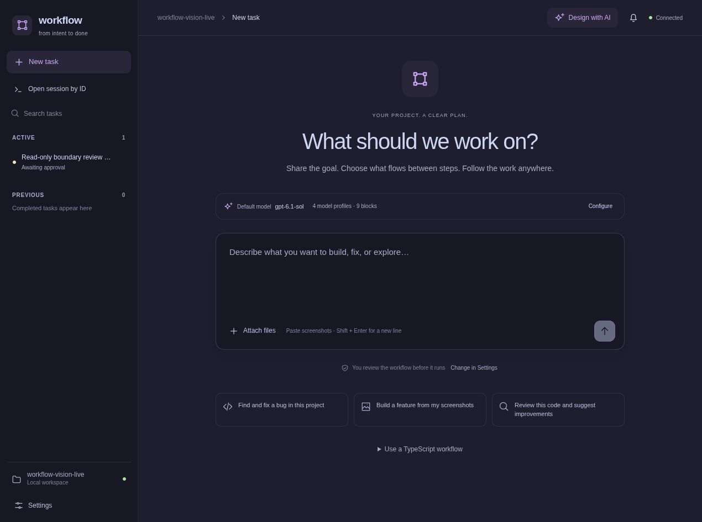

# Getting started

[Documentation](README.md) → Getting started

This guide takes you from a checkout of Workflow to an approved task in your own project. For the mental model first, read [Concepts and design](concepts.md).

## Requirements

- Bun **1.4.2 or newer** and Bash.
- Git for workflows that inspect, commit, or push repository changes.
- The tools your project uses: for example, its test runner or compiler. A block invoking `node`, Python, or another runtime needs that executable installed.
- A terminal or browser. ChatGPT sign-in or another provider's API key is needed for AI planning and execution; code-only imported workflows can run without a model.

Workflow includes its UI and manages a local Temporal development server. The first server start downloads a pinned Temporal executable; later starts use the cache. No separate Docker, Node.js, or Temporal installation is required for Workflow itself. Managed Temporal supports Linux/macOS x64/arm64; integration testing is performed on Linux.

## Install once

From the Workflow checkout:

```sh
bun install --frozen-lockfile --ignore-scripts
bun run build
bun link
```

`bun link` registers the `workflow` command. If the shell cannot find it, `bun pm bin -g` prints the directory that needs to be on PATH.

You do not install Workflow's dependencies in every target project. The command serves the bundled UI from its own installation and works on the folder where you run it.

### Run without linking

After building, call the CLI by its absolute path from the target project:

```sh
cd /path/to/your/project
bun /path/to/workflow/dist/cli.js init
bun /path/to/workflow/dist/cli.js
```

To work on the Workflow repository itself, run `bun run start` from its checkout. Its example `.workflow/` configuration is already present. `bun run dev` starts the live backend and a hot-reloading frontend at **http://127.0.0.1:5173**; [development mode](development.md) is for editing the application.

## Initialize your project

```sh
workflow login openai
workflow model
cd /path/to/your/project
workflow init --instructions "Preserve public APIs. Use the existing test framework."
workflow setup
workflow                       # returns after the background host is ready
```

Open **http://127.0.0.1:4310**. The current directory is the project; there is no positional project-path argument and no parent-directory configuration search.

Initialization creates `.workflow/`, starter blocks, task instructions, and defaults. If `package.json` has a `test` script, the starter checks use `bun run test`. Otherwise, configure an appropriate check in Settings before relying on test-based completion.

Initialization never calls a model and refuses to overwrite existing configuration. `--no-ai` is still accepted for older scripts but is no longer needed.

`workflow setup` is the explicit AI bootstrap. Your saved default inspects the repository and proposes model profiles, task instructions, and reusable TypeScript blocks. All three proposals are validated before publishing; generated block source is typechecked. Task instructions describe review, bug-fix, feature, and documentation work without forcing every request through a fixed graph. The default planner composes the actual graph later.

The command starts a saved background job and prints its ID. Follow it in Settings, with `/setup` in the TUI, or with `workflow setup --wait`. `workflow setup-status` reports progress and spending. After a failure or host restart, `workflow setup-resume <job-id> --wait` retries the unfinished stage while keeping earlier accepted proposals. Closing either interface leaves the core job running.

Choose a project-specific default with `workflow setup --model openai/gpt-6.1-sol --thinking medium`, or select it in Settings before running setup. Omit those flags to use the existing project/shared default. Setup uses the connected model catalog; a model name in a guide is not a guarantee of account access. Repeating completed setup keeps the saved library; use `--regenerate` to redesign it. Check the generated commands and blocks in Settings before using them on consequential work.

## Connect a model

1. Open **Settings → Providers & models**.
2. Choose **Continue with ChatGPT**, follow the sign-in link, and complete authorization. Return to Workflow after the callback says authentication succeeded.
3. Alternatively, expand **Use an API key**, select a provider, and save its key.
4. Select an available project model and thinking level, then save.
5. Use **Settings → Providers & models → Generate project setup** or run `workflow setup` for the full bootstrap. The saved job can be followed and resumed from either interface. Section-specific **Generate with AI** remains available for focused settings changes.

Workflow offers account sign-in for ChatGPT and API keys for other providers. Use the connected catalog to choose models; availability depends on the connection. Refresh connections and models if a new selection is missing. Existing drafts keep their saved model choices, so changing defaults does not repair an already-created draft automatically.

Credentials are stored outside the project. Pi does not need to be installed or logged in separately. See [Configuration](configuration.md) for storage details and model precedence.



## Run your first task

Start with a request whose result you can judge:

> Review the exported functions in `src/math.ts` for edge cases. Do not edit files. Return findings with file and line references, or state that you found none.

Or, for an implementation:

> Add a clamp function that returns values within the supplied min/max range and throws when min exceeds max. Add focused tests, run them, and review the change. Do not commit or push.

1. Select **New task**, enter the request, and attach relevant screenshots, specifications, or error output.
2. The coordinator selects task instructions and composes a graph. It asks a follow-up only when essential information is missing.
3. Read the rationale, steps, model choices, and connections. Repository investigation belongs to the execution steps, so planning does not need to inspect your codebase.
4. Use **Edit workflow** to change the TypeScript or ask AI to refine the draft. **Format** or **Shift + Alt + F** formats code with Prettier. Save before approving.
5. Select **Approve & start**. In automatic mode, selected in **Settings → Execution**, an accepted workflow starts without this click.

During execution, active blocks are highlighted. Select a block for its inputs, visits, and activity. Drag graph blocks to arrange them, use **Fit workflow**, or expand the workspace. Layout changes do not change execution order.

Unsent task text and uploaded attachment references are saved per project in this browser. Opening Settings, switching sessions, or refreshing the page preserves the draft. **New task** returns to it; **Discard task draft** clears it. Successful submission clears only the submitted draft, preserving any newer edits. File bytes remain in the project's attachment store. If browser storage is disabled, the draft still survives navigation within the open page.

The outcome appears above the graph. **Results** contains rendered summaries, checks, and artifacts; **Activity** contains detailed events and command output. Copy or download Markdown from results. Active and previous tasks remain in the sidebar.

## Attachments

You can select files, drag them into the composer, or paste screenshots:

| Type                  | Limit                               |
| --------------------- | ----------------------------------- |
| PNG, JPEG, WebP, GIF  | 6 MB each                           |
| UTF-8 text/code files | 256 KB each                         |
| Whole request         | Up to 8 attachments and 20 MB total |

PDF and general binary document extraction are not implemented. Image requests need an image-capable planning model. Uploaded content is supplied to the selected model providers; request attachments are stored privately under `.workflow/attachments/`.

## Import a workflow you wrote

Choose **New task → Use a TypeScript workflow** to paste or import a `.ts` file and provide a JSON input object. The source is typechecked and a declared composition gets a graph preview before approval.

You can also save source inside your project and use a second terminal while its Workflow server is running:

```sh
workflow run verify.ts --input '{"request":"Verify this project"}'
# To start the imported workflow immediately:
workflow run verify.ts --input '{"request":"Verify this project"}' --approve
```

The CLI discovers this project's running server and checks that it serves the same project. Use `--port` or `--server` to select an endpoint explicitly. It submits the workflow and returns its ID; it does not wait for the final result.

Open any saved task or run with `workflow attach <id>`. In the browser, use **Open session by ID** or a copied session link. Both clients show the same saved state and receive live updates. `workflow resume <run-id>` is a separate command that explicitly restarts paused/interrupted execution.

The compiler resolves `import { workflow, block, step } from "workflow"` to the installed SDK. You do not need to install a package named `workflow` in the target project.

## Next steps

- [Concepts](concepts.md): understand the difference between a task, block, step, and run.
- [Writing workflows](workflows.md): compose loops, conditions, and parallel work.
- [Configuration](configuration.md): customize profiles, instructions, blocks, skills, and MCP.
- [Operations](operations.md): pause, recover, retry, and diagnose failures.

Use `workflow status` to find the host URL and `workflow stop` to stop it. Closing the browser or terminal workspace leaves execution running. For a foreground process, run `workflow serve` (or `bun run start serve` from the source checkout).
