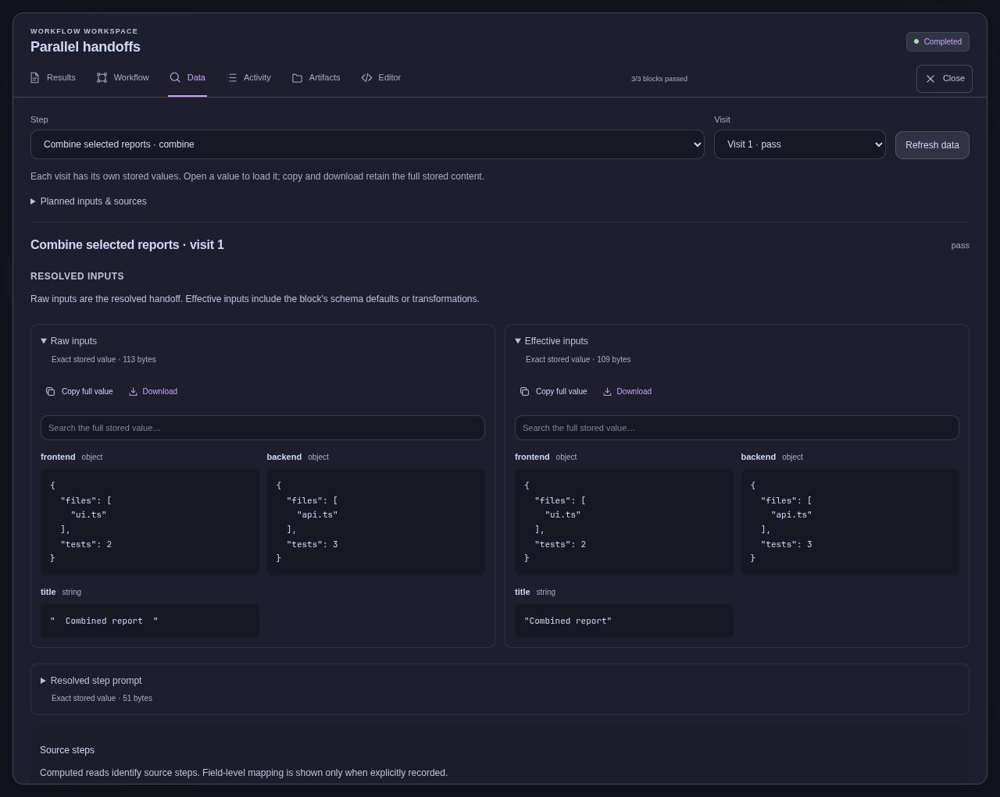
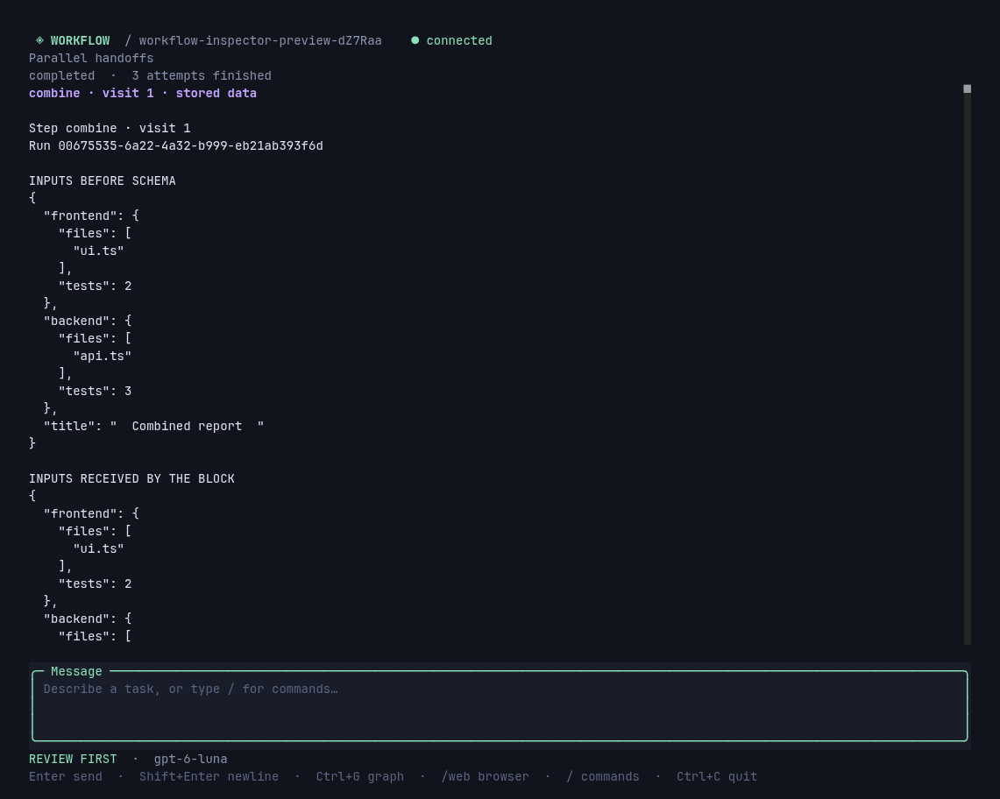

# Inspecting workflow data

[Documentation](README.md) → Inspecting workflow data

Open a workflow's **Data** tab and choose a step and visit. Each invocation has its own saved inputs, output and model sessions. Selecting an earlier visit shows that visit's data even after a loop or retry produces a newer result. This evidence is stored separately from the activity feed and remains available after older events leave that feed.



This is a completed run of the pure TypeScript handoff example. It made no AI requests.

## Inputs and outputs

**Raw inputs** are the named values supplied to the invocation. **Effective inputs** are the values after the block's input schema applies validation, defaults or transformations. For example, `z.string().trim()` can turn `"  Combined report  "` into `"Combined report"`. Both values remain inspectable. If validation fails, the raw value and validation error remain available, while the effective input is marked unavailable.

The output includes the typed return value, summary, outcome and named artifacts from that visit. Search, copy or download the stored values. A pending output means the visit has not produced a settled result; it is not an empty successful result.

Before execution, the inspector shows declared literals and deferred inputs. A deferred callback resolves only when the step starts. Previewing a draft never runs that callback or invents its future values.

## Multiple producers and parallel work

A consumer can take selected outputs from several earlier blocks:

```ts
const compare = step("compare", compareReports, {
  inputs: ctx => ({
    frontend: ctx.output(frontend)!,
    backend: ctx.output(backend)!,
  }),
});

const flow = sequence(parallel([frontend, backend]), compare);
```

The parallel join makes both completed results available. Each named input keeps its JSON type and structure. The inspector records reads from producer steps, including their actual visit numbers. When ordinary TypeScript combines or transforms several outputs, these records identify the steps used in the calculation; they do not claim an exact field mapping that the code did not declare.

Try [parallel-handoffs.ts](../examples/parallel-handoffs.ts). Its two sample report blocks and consumer use ordinary TypeScript, so it makes no model requests. The consumer receives only the selected reports. It does not inherit earlier model conversations.

## AI context

Each captured AI session is associated with its step visit, operation and usage record. Inspect the selected model and thinking level, context mode, caller prompt, application system prompt, selected tool definitions, initial or continuation prompts, and recorded tool inputs/results. Reported usage uses the same session identity as the cost view.

This is the context supplied by Workflow and its embedded session runtime. It does not expose provider internals or hidden model reasoning. `context: "none"` continues to exclude inherited workflow context; the inspector lets you check what was actually supplied.

## Terminal and CLI

In the TUI, `/data` opens the visit picker. `/data combine 1` opens a particular visit. The view is a snapshot; repeat the command to refresh it.



```sh
workflow data <run-id> combine 1
workflow data <run-id> combine 1 --json > step-data.json
```

Omitting the visit selects the latest recorded visit for that step. JSON exports contain the evidence metadata and a `contents` map keyed by content hash. Available entries contain the exact stored text; JSON values can be parsed from that text. Binary content remains available through download links. The CLI loads up to 16 MiB per export; the terminal loads up to 256,000 bytes and bounds its rendered text. Any omitted content includes an explicit reason and a link to the complete stored content.

## Storage and limits

Evidence lives in private, ignored files beneath the run's attempt directory. It can include project content and prompts, so include it in your normal project-state backup and retention decisions. The HTTP reader accepts validated run/step/visit/content identities, not arbitrary file paths, and verifies content hashes.

Raw inputs, effective inputs and tool-feedback JSON values are limited to 2 MiB each, with an 8 MiB combined input capture bound. Application text, tool definitions and image content have an 8 MiB limit per stored value. Oversized or unsupported values are labeled unavailable rather than silently converted or truncated. A schema can produce a `Date`, a class instance or another value that is not lossless JSON; the block can still use it normally even when the inspector cannot persist it as an exact JSON value. Evidence recording does not consume the block's operation allowance.

Older workflows may lack exact input or session-context evidence. The inspector labels those gaps; it does not reconstruct historical values from the current files or the latest visit.
