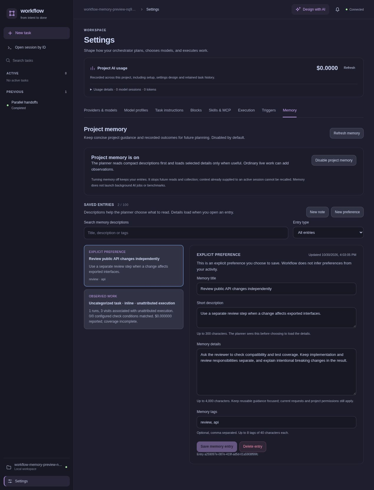

# Project memory

[Documentation](README.md) → Project memory

**Alpha:** Project memory is marked experimental in Settings.

Memory is optional and **disabled by default**. Enable it in **Settings → Memory** when you want the planner to consult compact project notes, explicit preferences and observations from ordinary work. It does not run benchmarks, launch separate model sessions, automatically retry failed jobs, or start paid summarization. Descriptions and selected detail reads use context and tool turns within the ordinary planning session; that usage is included in its cost accounting.



This disposable project contains an example preference and an observation from a completed pure TypeScript workflow. No AI requests were made for the example.

## What is remembered

- **Notes** contain project guidance you choose to keep.
- **Preferences** contain instructions you explicitly save, such as how you like changes reviewed. Workflow does not infer personal preferences from your activity.
- **Observations** aggregate recorded execution facts by task type, reusable block and model. They include outcomes, checks, usage and a few source references. A completed job is an observed result, not proof that a model is better or that every change was correct.
- **Strategies** record an approach you explicitly chose to remember after a workflow completed. They contain compact guidance and source metadata, not a fixed execution graph. See [Reusing an approach](reusing-approaches.md).

Observations come from normal live runs started while memory is enabled. They do not copy prompts, outputs, full graphs or conversations. Existing historical runs are not automatically imported when you enable memory. Code without model evidence is identified separately rather than attributed to an assumed model.

## Control what the planner sees

The planner starts with compact descriptions. It can search or list further entries and load the details of a selected memory. These notes are advisory: the current request, available models, configured capabilities, validation and approvals still apply. The planner cannot create preferences or edit memory through its tools.

Settings lets you inspect, edit and delete entries. Saving notes does not enable memory. Turning memory off retains saved entries while stopping new collection and future planner reads. Information already sent to an active model session cannot be recalled; disabling memory does not launch a replacement planning session.

Deleting an observation removes its accumulated facts. Already-started work does not recreate that group after deletion; future runs can create a fresh aggregate. Turn memory off to stop collection altogether.

Memory stays in private project state under `.workflow/`. Keep descriptions concise and details focused on reusable guidance. The store has explicit bounds, and adding an entry to a full store requires removing an entry first.

## Terminal and CLI

Use `/memory` in the terminal workspace to browse entries and change the setting. `/memory on`, `/memory off`, and `/memory <entry-id>` work directly. The CLI uses the same core service:

```sh
workflow memory
workflow memory on
workflow memory show <entry-id> --json
workflow memory add note.json
workflow memory update <entry-id> changes.json
workflow memory remove <entry-id>
workflow memory off
```

For `add`, provide a JSON file such as:

```json
{
  "kind": "preference",
  "title": "Review expectations",
  "description": "How to organize review for changes to public APIs.",
  "details": "Keep public API review independent from implementation. Explain compatibility changes in the result.",
  "tags": ["review", "api"]
}
```

For `update`, include the same editable fields and omit `kind`. Include the `revision` from `workflow memory show <entry-id> --json` to detect changes since you read the entry. If omitted, the CLI reads the current revision immediately before applying the command. A conflict leaves the saved entry unchanged. The web editor retains your draft text when a conflict occurs.

The store allows 100 entries, titles up to 100 characters, descriptions up to 300, and details up to 4,000. The initial planner catalog contains at most 32 descriptions; further descriptions and details are loaded only through selected reads. Automatic observations retain only five recent source references per aggregate and cumulative factual counts. When space is needed, collection can replace the oldest unedited observation; it preserves notes, preferences and observations you have annotated. If no such space is available, it skips new aggregates without failing the workflow.
