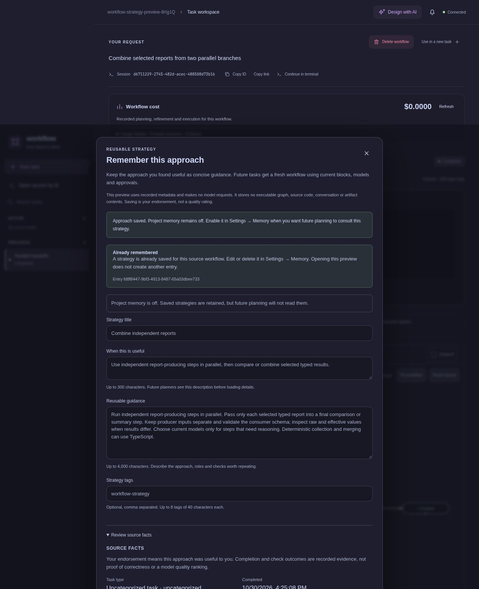
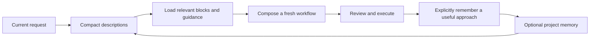

# Reusing an approach

[Documentation](README.md) → Reusing an approach

When a workflow worked well, use **Remember this approach** on its completed result. Review the proposed name, when it is useful, and reusable guidance before saving. This records your endorsement and a compact account of the approach. It does not save the execution graph as a mandatory template.

The preview and save use ordinary code. They make no model requests. Saving while project memory is off leaves it off; enable memory in **Settings → Memory** when you want future planners to consult the saved guidance.



This screenshot shows a real save in a disposable project after the pure TypeScript parallel handoff example completed. The edited guidance describes the approach; no model request was needed.

## What carries forward

A strategy entry keeps editable guidance and bounded source metadata about the task type, responsibilities, model choices, and recorded outcomes. Source metadata is separate from your annotations. It does not copy the workflow's source, complete graph, conversation, prompts or artifacts. Your endorsement expresses that the approach was useful; it does not certify every result or rank a model's quality.

Future planning receives the strategy's description alongside other enabled memory descriptions. It can load the details when relevant, then compose a fresh workflow for the current request. Current project instructions, model availability, validation and approval still apply. Previously used models are historical hints, not mandatory assignments.



## Blocks and task instructions load on demand

The planner initially receives block names and descriptions. `list_blocks` searches or pages that catalog, and `load_block` reads a selected block's definition, input/output contract, or TypeScript source. Large selected values are paged with exact offsets and an explicit continuation marker. A description helps discovery; source and contracts establish what a block actually accepts and returns.

Task instructions such as review, bug fix, feature work or documentation already follow the same pattern: descriptions first, then `choose_task_case` loads the relevant instructions. A saved approach adds optional guidance about a useful strategy without fixing the graph's structure.

Refinement reads the run's frozen block catalog, so later library edits do not silently change what a saved workflow means. New blocks suggested within a planning session are immediately available to that session's catalog tools. TypeScript, schema and model validation still run before a proposal is accepted.

Keeping unused source out of initial prompts reduces unnecessary context. Selected reads still use tokens and tool turns within normal planning; the shared usage view accounts for those costs. Workflow does not launch extra sessions to summarize, benchmark or rank saved approaches.

Manage saved strategies alongside other entries in [Project memory](memory.md). You can edit the guidance or delete an entry without changing the original workflow.

## Terminal and CLI

Open a completed run in the terminal workspace and enter `/remember` to inspect its compact preview. Nothing is written until `/remember save`. Switching sessions clears that preview. If another client changes memory or the source run, saving can reject the stale preview; read `/remember` again before deciding to save.

```sh
workflow remember <run-id>                    # preview only
workflow remember <run-id> --json             # compact preview and metadata
workflow remember <run-id> --save             # explicit save, no execution approval
workflow remember <run-id> --save --input '{"description":"Useful for independent API review"}'
```

`--input` accepts edited `title`, `description`, `details` and `tags`. Metadata comes from the core's saved run and cannot be supplied through this input. There is one remembered strategy per source run. Repeating an identical save returns the existing entry; conflicting guidance is preserved for review instead of silently overwritten. Use Memory settings or `workflow memory update` to edit an already saved strategy.

Completed demo runs can also be remembered, but their metadata is labeled simulated. Checks and model hints from a demo are not evidence of real execution quality.
